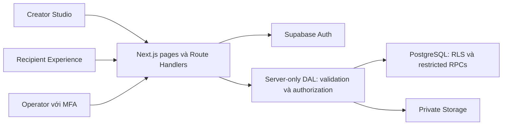

# SecretLove

Nền tảng tạo và chia sẻ thư kỹ thuật số riêng tư qua liên kết hoặc mã QR. Người gửi soạn thư trong Creator Studio; người nhận mở Private Letter Gate rồi trải nghiệm phong bì, trái tim hạt 3D, ảnh kỷ niệm và nội dung thư cùng nhạc nền tùy chọn.

**Website:** [secretlove-production.vercel.app](https://secretlove-production.vercel.app)

Website public không đồng nghĩa nội dung thư public. Creator phải được duyệt; người nhận không cần tài khoản Creator nhưng phải vượt qua gate do người gửi cấu hình. Tên và ngày sinh chỉ là yếu tố kiểm tra có độ bảo đảm thấp, không phải xác minh danh tính mạnh.

## Trạng thái dự án

Cập nhật ngày **17/10/2026**. Các tính năng dưới đây có trong source; mức nghiệm thu local, browser, hosted và xác nhận của operator được ghi riêng trong các báo cáo.

| Phạm vi | Trạng thái |
| --- | --- |
| Creator Studio, recipient scenes, private media, chia sẻ link/QR | Đã triển khai trong source; không đồng nghĩa mọi kiểm tra Production đã PASS |
| Production public + Private Letter Gate | Đã mở theo phê duyệt của chủ dự án, kèm các ngoại lệ kiểm thử được chấp nhận ở G7 |
| Operator registry, TOTP MFA, Creator approval, report/hold và privacy/request pages | Đã triển khai; onboarding và quyền operator do chủ dự án quản lý |
| G8.1/G8.2 | Runbook và đợt quan sát HTTPS ban đầu hoàn tất; không phải monitoring liên tục hoặc SLA |
| G8.3 cleanup | **Tạm hoãn** sau một lần gọi được duyệt trả HTTP **401**; không tự retry, không xóa marker; chưa xác nhận worker chạy hoặc dọn dữ liệu thành công |
| G8.4/G8.5 | Tabletop và hồ sơ review hoàn tất trong phạm vi tài liệu; khôi phục/rollback thực tế và operational acceptance đầy đủ chưa được nghiệm thu |

Nguồn trạng thái mới nhất: [TASKS.md](TASKS.md), [báo cáo G7](docs/G7_PUBLIC_ACCESS_REPORT.md), [G8 completion review](docs/G8_COMPLETION_REVIEW.md). Báo cáo cũ là bằng chứng tại thời điểm chạy, không thay thế trạng thái hiện tại.

## Tính năng

### Creator Studio

- Đăng nhập email/password, email callback, đăng xuất và password recovery có proof dùng một lần.
- Onboarding theo lời mời và phê duyệt Creator; không mở đăng ký Creator đại trà.
- Dashboard lấy dữ liệu thật từ Supabase, quản lý nhiều thư theo từng chủ sở hữu.
- Tạo, lưu, tải lại, preview và xóa thư; kiểm soát revision, thay đổi chưa lưu và thao tác đồng thời.
- Biên tập rich text, thông tin người nhận và passphrase tùy chọn.
- Hai template `rose` và `minimal`.
- Upload ảnh riêng tư, mô tả ảnh và chuẩn hóa ảnh trên server.
- Upload một MP3 được phép sử dụng cho mỗi thư; enable/disable, âm lượng mặc định, loop, preview, thay thế và gỡ track.
- Tùy chỉnh nội dung Heart/Closing và các cụm chữ tiếng Việt/Anh trên vòng chữ 3D.
- Publish, tạo liên kết/QR và unpublish. Thư published phải unpublish trước khi sửa; republish thay liên kết và vô hiệu hóa quyền truy cập cũ.

### Recipient Experience

1. Mở liên kết và xem landing không chứa nội dung riêng tư.
2. Nhập tên/ngày sinh và passphrase nếu được yêu cầu; server kiểm tra và cấp session gắn với một thư.
3. Mở phong bì, tương tác trái tim hạt màu hồng và các vòng chữ 3D.
4. Xem gallery, đọc thư và lời kết; di chuyển giữa các scene.

Scene Renderer dùng cấu hình JSON có version và registry component tin cậy. Không thực thi JavaScript hoặc code do Creator cung cấp. Có responsive layout, reduced-motion và fallback cho trường hợp không dùng được WebGL.

Một music player tồn tại xuyên scene. Nhạc bắt đầu qua thao tác người dùng phù hợp với chính sách trình duyệt; có thể cần tương tác lại nếu trình duyệt chặn. Creator có preview controls; giao diện recipient hiện dùng soundtrack nền theo yêu cầu sản phẩm. Không thể bảo đảm autoplay có âm thanh hoặc ngăn người đọc tắt tiếng bằng trình duyệt/hệ điều hành. Lỗi audio không được ngăn đọc thư đã được cấp quyền.

### Operator và privacy

- Operator phải có registry riêng và TOTP MFA trước các thao tác quản trị được bảo vệ.
- Duyệt/suspend Creator, review report, hold/clear thư và xử lý yêu cầu theo quyền server-side, revision và audit.
- Report không tự động đình chỉ thư theo số lượng; operator xem xét quyết định.
- Close thu hồi session recipient hiện tại; không hứa chặn một người trên mọi thiết bị.
- Xóa logic/thu hồi quyền và xóa vật lý media là các bước riêng. Cleanup queue có trong source, nhưng G8.3 hiện tạm hoãn.

## Công nghệ và kiến trúc

| Thành phần | Công nghệ |
| --- | --- |
| Ứng dụng | Next.js App Router 16, React 19, TypeScript |
| Giao diện | Tailwind CSS 4, Motion, Tiptap |
| 3D | React Three Fiber, Three.js; procedural particle heart |
| Backend | Supabase Auth, PostgreSQL, RLS, private Storage |
| Validation/media | Zod, Sharp, MP3 decoder |
| Kiểm thử | Vitest, PGlite, Playwright |
| Hosting | Vercel, Node.js runtime |
| Package manager | pnpm 11.25.0; phiên bản cụ thể xem package.json/pnpm-lock.yaml |



Owner reads dùng identity đã được xác thực và RLS. Privileged writes đi qua server-only DAL/RPC và kiểm tra ownership/approval lại trên server. Service credential vượt qua RLS nên không thay thế các kiểm tra này.

Media đi qua endpoint cùng origin đã kiểm tra quyền. MP3 lớn được upload theo chunk khoảng 1 MiB vào private staging rồi validate/attach; download dùng streaming với backpressure/cancellation và HTTP Range. Browser không nhận server key, object path hoặc permanent public Storage URL. Kiểm tra live modern-key/Range/streaming còn thiếu không được suy ra PASS từ mock tests.

## Chạy local

### 1. Chuẩn bị

- Node.js **22 trở lên**, pnpm **11.25.0**.
- Supabase **development/test riêng**, không dùng Production để thử fixture, migration hoặc browser tests.
- Email Auth và SMTP phù hợp khi cần kiểm thử lời mời/recovery thật.

```powershell
pnpm --version
pnpm install --frozen-lockfile
```

Nếu pnpm chưa có, cài/kích hoạt đúng phiên bản theo môi trường Node của bạn; không thay lockfile chỉ để vượt lỗi cài đặt.

### 2. Cấu hình môi trường

Dùng [.env.example](.env.example) làm danh sách biến. Chỉ tạo `.env.local` nếu chưa tồn tại; **không ghi đè file đang dùng**. Không đưa giá trị secret vào Git, chat, screenshot hoặc báo cáo.

| Biến | Mục đích |
| --- | --- |
| `NEXT_PUBLIC_SUPABASE_URL` | URL Supabase của môi trường local |
| `NEXT_PUBLIC_SUPABASE_PUBLISHABLE_KEY` | Publishable key được phép dùng ở browser |
| `SUPABASE_SERVICE_ROLE_KEY` | Server-only credential; ưu tiên modern `sb_secret_`, tên biến được giữ để tương thích |
| `APP_ORIGIN` | Origin chính xác, ví dụ `http://localhost:3000`; không có dấu `/` cuối |
| `VERIFICATION_HMAC_KEY` | Bảo vệ dữ liệu kiểm tra và recovery proof; cần kế hoạch khi rotate |
| `RATE_LIMIT_HMAC_KEY` | HMAC cho định danh rate limiting |
| `CRON_SECRET` | Bearer authorization của cleanup; không phải Supabase key |
| `MAX_AUDIO_UPLOAD_BYTES` | Tùy chọn hạ giới hạn audio; tối đa `16777216` bytes |
| `PRIVACY_CONTACT_EMAIL` | Email thật của operator cho giao diện privacy/request; bắt buộc trong public deployment guard |

Ba application secrets phải độc lập, ít nhất 32 random bytes dạng canonical base64. Lưu giá trị riêng cho từng môi trường và giữ liên tục khi cần đọc gate đã lưu. Không tái sử dụng key đã lộ. Rotation verification HMAC có thể đòi hỏi cấu hình lại recipient gate; session recipient trong database không tự bị revoke chỉ vì đổi HMAC.

Local dùng origin loopback; không đổi sang IP LAN hoặc wildcard để vượt Origin check. Đọc [SECURITY.md](docs/SECURITY.md) trước khi sửa auth, cookies, callbacks hoặc Storage.

### 3. Database và tài khoản

Migration có thứ tự **001 → 009** trong [supabase/migrations](supabase/migrations). Không sửa migration đã áp dụng, không reset database, không chạy lại hàng loạt migration trên backend hiện hữu. Thực hiện theo hướng dẫn tương ứng và kiểm tra read-only sau mỗi bước.

| Migration | Nội dung |
| --- | --- |
| 001 | Creator Studio, private recipient records, RLS và media cleanup nền tảng |
| 002 | Recipient experience và restricted access gateways |
| 003 | Background music |
| 004 | Full-song audio limits |
| 005 | Heart/Closing scene text |
| 006 | Particle heart và text rings |
| 007 | Single-use recovery consumption |
| 008 | Private chunked audio ingests/staging |
| 009 | Creator approval, operator/report/moderation/audit controls |

Migration 009 được thiết kế cho backend mới theo workflow public release. Không tự áp dụng vào historical test backend có dữ liệu cũ; cần review riêng cho backend development mới. SQL Editor execution cũng không tự đồng bộ Supabase CLI migration history.

Xem [setup nền tảng](docs/SETUP.md), [chunked audio setup](docs/CHUNK_AUDIO_SETUP.md), [G4 configuration preparation](docs/G4_CONFIGURATION_PREPARATION.md) và [G3 release controls](docs/G3_PUBLIC_RELEASE_IMPLEMENTATION.md). Bootstrap operator, mời tài khoản và duyệt Creator là thao tác riêng, không có auto-seed tài khoản đặc quyền. Email confirmed không tự cấp quyền Creator/operator.

### 4. Khởi chạy

```powershell
pnpm dev
```

Mở `http://localhost:3000`. Creator được duyệt dùng `/studio`; operator dùng `/operator/security` để thực hiện MFA rồi vào `/operator`. Recipient vào link `/l/<shareToken>` do ứng dụng tạo.

## Kiểm thử

| Lệnh | Phạm vi / điều kiện |
| --- | --- |
| `pnpm typecheck` | Sinh Next.js types và kiểm tra TypeScript |
| `pnpm lint` | ESLint |
| `pnpm test` | Vitest, local/mock/PGlite tests; live tests có opt-in riêng |
| `pnpm build` | Local production build; không phải deployment hoặc hosted acceptance |
| `pnpm check:supabase` | Dùng `.env.local`, thực hiện kiểm tra kết nối/quyền thật; chỉ chạy trên backend được phép |
| `pnpm test:live` | Live isolation smoke với prerequisite tài khoản test riêng; không chạy tùy tiện trên Production |
| `pnpm test:browser` | Playwright; một số suite có fixture mutations/email prerequisites và phải được duyệt đúng môi trường |

Các kiểm tra local thông thường:

```powershell
pnpm typecheck
pnpm lint
pnpm test
pnpm build
```

Browser prerequisites gồm `pnpm exec playwright install chromium` và thiết lập isolated test theo [SETUP.md](docs/SETUP.md). Không bật test live, đổi fixture, gọi cleanup hoặc gửi email chỉ để làm các test bị SKIPPED thành PASS. Xem từng test/report trước khi chạy; test mock, xác nhận operator và request thật là các loại bằng chứng khác nhau.

## Giới hạn media và bảo mật

- Ảnh: JPEG/PNG/WebP không animation, tối đa **3 MiB**, tối đa 4096 px mỗi chiều; server decode, rotate và chuẩn hóa WebP, không tin extension/MIME từ client.
- Nhạc: một MP3/thư, tối đa **16 MiB và 360 giây**; cấu hình server có thể thấp hơn. Người gửi phải có quyền sử dụng và chia sẻ nhạc.
- Storage `letter-media`, `letter-assets`, `letter-audio-staging` đều private; không sửa sang public để khắc phục lỗi.
- Recipient session gắn thư/access version; server kiểm tra expiry, revoke, publication, moderation và Creator approval cho content/media.
- Rich text và cấu hình scene được validate/render theo allowlist; không nhận arbitrary HTML/JS hoặc external music URLs.
- Private responses dùng no-store; metadata/landing không được chứa nội dung thư hoặc recipient verification secrets.
- Hệ thống **không mã hóa đầu cuối**; không ngăn người đã xem chụp màn hình, thu âm hoặc lưu dữ liệu đã nhận. Revocation chặn request tiếp theo, không thu hồi bytes đã giao.

Chi tiết: [Security](docs/SECURITY.md), [Database](docs/DATABASE.md), [API contracts](docs/API.md).

## Deployment và vận hành

Vercel chạy build guard trước `pnpm build`; guard nằm ở [scripts/check-preview-config.mjs](scripts/check-preview-config.mjs) và [scripts/preview-settings.mjs](scripts/preview-settings.mjs). Các mode Preview, `owner-only-review`, `public-private-gate` có điều kiện khác nhau. Public Production bị ràng buộc vào project/team, exact origin và backend được duyệt trong [config/public-deployment.json](config/public-deployment.json).

Không spoof `VERCEL_ENV`, bỏ guard, dùng wildcard Origin hoặc đổi binding chỉ để deploy được. Ngoài các biến ứng dụng, public build cần `SECRETLOVE_DEPLOYMENT_MODE`, `SUPABASE_PROJECT_REF`, `ENABLE_EXPERIMENTAL_COREPACK` cùng system context của Vercel; xem [DEPLOYMENT.md](docs/DEPLOYMENT.md) để cấu hình đúng scope. Email Auth cần exact callback URL và SMTP không rewrite recovery/invite links.

Source hiện có Git auto-deployment tắt và `crons: []`. **Git push không phải quyền deploy.** Không tạo deployment, alias, scheduler hoặc thay đổi Protection nếu chưa có phê duyệt tương ứng.

Cleanup endpoint có authorization nhưng **là thao tác thay đổi dữ liệu toàn project**, không phải health check. Nó có thể prune record, xử lý pending media/ingest, xóa queued objects/tombstones và scan orphan. Không gọi bằng browser, probe lại khi lỗi hoặc giả định chỉ ảnh hưởng một thư. Một request timeout/partial không bảo đảm rollback các tác động đã commit.

G8.3 hiện **tạm hoãn sau HTTP401**. Giữ nguyên attempt marker trong ignored local artifacts; không tái sử dụng lần phê duyệt đã tiêu thụ. Cần chẩn đoán, preflight và phê duyệt riêng trước lần mới. Không hứa thời hạn xóa vật lý, backup restore, log retention hay SLA chưa được xác minh.

## Cấu trúc repository

```text
src/app/                  Pages, layouts, API Route Handlers
src/components/           Studio, recipient scenes, music, operator UI
src/lib/server/           Server-only DAL, authorization, media, cleanup
src/lib/validation/       Zod schemas và dữ liệu đầu vào
src/lib/supabase/         Supabase browser/server/service clients
supabase/migrations/      Migration SQL có thứ tự, không sửa lịch sử
config/                   Reviewed deployment binding
scripts/                  Build guard và công cụ kiểm tra
tests/                    Local, integration và browser tests
public/                   Public assets; không chứa private uploads
docs/                     Thiết kế, setup, báo cáo và runbook
```

`.env.local`, `.vercel`, account inventories, fixture credentials và `test-results` không thuộc commit. `.vercelignore` còn loại internal docs/references/test artifacts khỏi upload hosting; không dùng nó thay cho `.gitignore` hoặc credential review.

## Tài liệu và roadmap

- [PRD](docs/PRD.md), [Architecture](docs/ARCHITECTURE.md), [Architecture review](docs/ARCHITECTURE_REVIEW.md).
- [Production workflow](docs/PUBLIC_PRODUCTION_WORKFLOW.md), [Production checklist](docs/PRODUCTION_CHECKLIST.md).
- [Security audit](docs/DAY3_SECURITY_AUDIT.md), [Deployment readiness](docs/DAY3_DEPLOYMENT_READINESS.md).
- [G6 current acceptance](docs/G6_CURRENT_ACCEPTANCE_STATUS.md), [G7 public access report](docs/G7_PUBLIC_ACCESS_REPORT.md).
- [G8 runbook](docs/G8_OPERATIONS_RUNBOOK.md), [completion review](docs/G8_COMPLETION_REVIEW.md), [incident tabletop](docs/G8_INCIDENT_TABLETOP.md).
- [TASKS.md](TASKS.md): acceptance evidence, FAIL, NOT TESTED và các gate còn mở.

Hướng phát triển chưa triển khai đầy đủ: advanced theme/background/font editor, drag-and-drop scene editor, tùy chỉnh animation/3D tự do và video processing. Live Storage/Range/isolation/revocation còn thiếu, cleanup/recovery thực tế và monitoring vận hành cần nghiệm thu riêng. Không coi roadmap hoặc owner-accepted exception là tính năng/kiểm thử đã hoàn thành.

## Đóng góp và báo lỗi

Đọc [AGENTS.md](AGENTS.md), dùng branch riêng và thay đổi đúng phạm vi đã duyệt. Không commit credentials, private letter links, nội dung thư, DOB, TOTP QR/seed, session cookie hoặc dữ liệu test cá nhân. Báo lỗi bằng mô tả, error code và các bước tái hiện đã loại dữ liệu nhạy cảm. Không đăng lỗ hổng kèm dữ liệu riêng tư lên public issue; liên hệ operator qua thông tin trên trang privacy của môi trường tương ứng.
