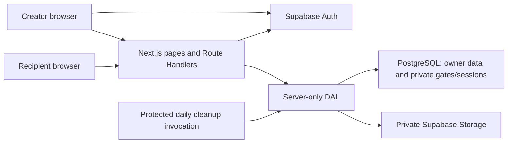

# SecretLove — Approved Architecture

Status: user-approved architecture. The user reordered implementation to Day 1 Creator Studio, including private uploads and basic owner preview. Publishing, sharing, recipient APIs/scenes and deployment are deferred. See [TASKS.md](../TASKS.md) and [SETUP.md](SETUP.md) for implementation evidence and manual Supabase configuration.

## 1. Architecture decision

Use one Next.js App Router application on Vercel, with Supabase Auth, PostgreSQL, and a private Storage bucket. Next.js Route Handlers form the application API; a shared server-only data access layer (DAL) performs authorization, validation, and persistence. No separate backend, Redis, queue service, or ORM for the MVP.

Use TypeScript and Tailwind. Server Components provide the shell and authenticated initial Studio data. Client Components provide editor/forms, QR generation, Motion scenes, and a lazy-loaded React Three Fiber heart. Use the Node.js runtime for image processing and passphrase hashing.



All private photo upload/download bytes pass through the authorized server. The recipient never receives a Supabase JWT, a service key, a Storage object path, or a signed Storage URL. This keeps future requests revocable at the application boundary.

## 2. Boundaries and authorization

### Creator identity

Use `@supabase/ssr` browser/server clients and the version-appropriate token-refresh integration. Validate creator identity server-side with `getUser()` for protected Studio data and API calls; do not authorize from a cookie-decoded object or `getSession()` alone. Restrict confirmation/recovery redirects to the application's allowlist. The refresh layer is a convenience; each entry point enforces authorization. Supabase documents the distinction between validated identity and raw session reads in its [SSR guide](https://supabase.com/docs/guides/auth/server-side/creating-a-client).

Normal owner reads use the creator's JWT and RLS. Application mutations go through the DAL and restricted transactional RPCs, using a server-only service client. The DAL derives `actorId` from verified authentication; a transaction checks `letters.owner_id = actorId` again under a row lock. Clients cannot supply a trusted actor ID. Anonymous/authenticated roles have no direct table write grants, preventing REST calls from bypassing lifecycle rules or changing server-managed fields.

This is a deliberate MVP tradeoff: service access concentrates risk in the DAL, but avoids separate permissive client write paths. Test every privileged entry point. Private tables are outside the exposed Data API schemas. Narrow RPC gateways in the exposed schema are executable only by the service role; they use explicit grants and a fixed search path. Prefer SECURITY INVOKER where the service role already has required privileges; no publicly callable privileged functions.

### Recipient identity

The share URL locates a letter; it never authorizes content access. The generic landing/bootstrap reads only publication availability and the passphrase-required boolean. Verification creates a separate, opaque, database-backed recipient session bound to letter ID and access version. Every protected content/media request checks expiry, revocation, publication/deletion state, and version before fetching data.

Do not use a creator's authentication cookie as an automatic recipient bypass. Owner preview has its own owner-authorized route and shares only rendering components with the recipient experience.

### Disclosure and caching

An unlocked content DTO contains only the display name, message document, template ID, and photo IDs/alt text. Verification hashes, share records, owner IDs, storage paths, DOB, and internal timestamps are never included. Authorized content may be held in page memory; no localStorage, persisted query cache, offline service worker, or background preload before verification.

The one timestamp exception is the current recipient session's expiresAt, returned by the authorized content API so reload/resume can schedule expiry correctly. Generic Continue reading calls that protected API and falls back to verification if unauthorized; it never extends or creates a session. No private data is fetched into the initial landing shell.

Private pages/APIs/media are dynamic and use `Cache-Control: private, no-store`; no shared/static rendering, ISR, CDN caching, or Next Image optimization for private media. Render photos from authenticated same-origin proxy URLs using ordinary images. Apply generic metadata, noindex, no-referrer, and frame restrictions. Next.js requires authorization at each public server entry point; see its [authentication guidance](https://nextjs.org/docs/app/guides/authentication).

## 3. Proposed source layout

```text
src/app/
  (auth)/login, signup, recover, reset-password
  auth/callback/route.ts
  (studio)/studio/page.tsx
  (studio)/studio/letters/new/page.tsx
  (studio)/studio/letters/[id]/edit/page.tsx
  (studio)/studio/letters/[id]/preview/page.tsx
  l/[shareToken]/page.tsx
  api/letters/.../route.ts
  api/recipient/[shareToken]/.../route.ts
  api/internal/cleanup/route.ts
src/components/
  studio/     # editor, gallery controls, template selector, share panel
  recipient/  # verification and reading sequence
  scenes/     # envelope, heart, memories, letter; shared with preview
  ui/         # accessible buttons, inputs, notices
src/lib/
  supabase/   # browser, request-scoped server, server-only service clients
  server/     # identity, ownership, letters, verification, sessions, media, cleanup
  validation/ # shared schemas; authoritative checks still run server-side
  rich-text/  # strict document schema and safe React renderer
  templates/  # fixed rose/minimal presentation config
supabase/migrations/
tests/        # unit, integration/RLS, browser smoke scenarios
```

This is a proposed structure, not an instruction to create these folders before approval.

## 4. Data and transactional behavior

Detailed tables, constraints, grants, and indexes are in [DATABASE.md](DATABASE.md). API payloads are in [API.md](API.md).

- **Draft:** explicit Save; optimistic concurrency using `version`. No autosave conflict resolution.
- **Publish:** row lock; verify owner, expected version, non-empty message, configured gate, and ready photos. Generate 32 random bytes encoded base64url for the share token. Store raw token only in a private share table for owner retrieval; SHA-256 digest indexes lookup. Return the link to the owner. Freeze changes.
- **Unpublish:** one transaction sets draft, increments access/version counters, and deactivates the share link. Subsequent content and media requests fail, even if a session row still exists.
- **Republish:** generate a fresh token and increment access version; old links/QRs cannot locate an active share.
- **Verify:** rate-limit before costly work; read minimal gate/version, compare normalized identity digest and passphrase hash; then atomically recheck current publication/access version under the same letter lock used by mutations before inserting a session. A stale successful comparison cannot issue a valid session after revocation.
- **Delete:** one transaction marks deleted, clears message/recipient fields, removes gates/shares/sessions/photo metadata, and queues photo object paths for removal. Storage retries occur separately; tombstone remains until cleanup finishes. No creator undo in the MVP.
- **Concurrency:** transactions serialize on parent letter; transaction-scoped creator advisory locks serialize the 20-letter quota without modifying Supabase Auth rows. Studio serializes its own writes/uploads and preserves unsaved form input. Photo reservation/finalization/removal each increment version. Finalization compares the parent's current version to the server-issued post-reservation version; intervening changes cause a safe conflict and cleanup. Advance editor version only after an uninterrupted operation; do not mask another tab's edits by blindly adopting a later upload version. No multi-request transaction simulated in TypeScript.

## 5. Media pipeline

1. Owner sends one image as multipart data to the letter's photo endpoint; reject over-limit bodies and non-drafts before processing.
2. Validate signature and actual decode; allow non-animated JPEG/PNG/WebP only; enforce 4096 px per dimension and 16 megapixels; apply orientation, re-encode and strip metadata. Reject decode failures/unsupported input and normalized output over 3 MiB. Never serve original bytes; re-encoding discards appended/embedded non-image data without claiming universal polyglot detection. No original is retained.
3. Reserve a pending photo/available slot transactionally (slots 0–5) under the letter lock. Use a generated path `{ownerId}/{letterId}/{photoId}.webp`; ignore client file paths/names.
4. Upload normalized bytes to private Storage without upsert. Finalize metadata only if the letter is still active/draft, the reservation/path matches, and the post-reservation version is still current; otherwise remove the failed reservation and queue the object for cleanup.
5. Return success only for a ready photo. Pending uploads block publication. Failed/stale reservations and orphan objects are reconciled by cleanup; clients see a retryable error.
6. Owner and recipient image endpoints authorize each GET and stream bounded bytes from Storage; no redirect/signed URL or cacheable response.

The 3 MiB per-file ceiling provides room under Vercel's documented [4.5 MB Function request/response limit](https://vercel.com/docs/functions/limitations). Confirm total multipart size and output limits on the chosen deployment; users must compress oversized photos for the MVP.

Storage grants deny browser/anonymous object reads, writes, and listing. Only the server service client accesses the private bucket; database ownership and letter membership are checked first. Supabase distinguishes [private and public buckets](https://supabase.com/docs/guides/storage/buckets/fundamentals); public buckets are prohibited here.

## 6. Recipient scenes and editor

- One Client Component controls `locked → envelope → heart → gallery → letter`. Only `locked → unlocked` depends on server authorization; animation is presentation, never a security boundary.
- Use the same safe rich-text renderer and scene components for owner preview and recipients. Small editor (e.g. Tiptap core/StarterKit configured to allowlisted nodes) with only the MVP toolbar. Evaluate compatible stable packages when approved.
- Lazy-import Canvas/heart after access; procedural geometry, low polygon count, no postprocessing. Pause/stop rendering when hidden and unmount after the heart scene.
- Respect `prefers-reduced-motion`; use static CSS/SVG fallback and explicit navigation. Static envelope/heart assets are generic and can be public; uploaded photos cannot.
- Fetch content after verification or an explicit server-authorized resume; use returned expiresAt for the client timer and proxy media on demand. On 401/404 or expiry timer, clear content state and return to verification/unavailable view. Previously received bytes cannot be recalled.

## 7. Libraries and external setup

Required runtime packages: Next.js/React/TypeScript, Tailwind, Supabase JS + SSR, Motion, Three.js + R3F, a small structured editor, schema validation (Zod), local QR encoding, and Sharp for trusted image decode/re-encode. Node `crypto` supplies randomness, HMAC, hashes, and async scrypt. Do not add Zustand, an ORM, Redis, or separate workers unless approval changes scope.

Test tooling: one unit runner and a browser runner for important journeys; database access tests against an isolated real Supabase/local test instance. Pin mutually compatible stable versions and security patches during Day 1; no versions are assumed installed.

Environment proposal:

| Variable | Exposure/purpose |
| --- | --- |
| `NEXT_PUBLIC_SUPABASE_URL` | Public project URL |
| `NEXT_PUBLIC_SUPABASE_PUBLISHABLE_KEY` | Public client key; grants/RLS must still deny private access |
| `SUPABASE_SERVICE_ROLE_KEY` | Server only; restricted DAL/Storage/RPC access |
| `VERIFICATION_HMAC_KEY` | Server only; random 32+ bytes; protects name/DOB digest |
| `RATE_LIMIT_HMAC_KEY` | Server only; separate random key for IP bucket identifiers |
| `APP_ORIGIN` | Server canonical HTTPS origin for links, CSRF/redirect allowlist |
| `CRON_SECRET` | Server only; authenticate cleanup invocation |

No secrets in `NEXT_PUBLIC_*`, source, tests, URLs, or log output. Keep production and preview secrets/data separate. Keys are provisioned after approval, never as hardcoded examples.

External configuration owned by the user:

| Service | Required setup before implementation/testing |
| --- | --- |
| Supabase | Isolated non-production and production projects; chosen region; email/password provider with confirmation; explicit site/callback allowlist; public URL/publishable key and protected service key. Schema/private bucket creation follows approved migrations. |
| Transactional SMTP | SMTP host/port/credentials, verified sender, provider-required DNS (SPF/DKIM/DMARC), appropriate auth-email rate limits, and a confirmation/recovery delivery test. Supabase's default sender is restricted to project-team addresses and is not suitable for external-beta signup; see its [SMTP guide](https://supabase.com/docs/guides/auth/auth-smtp). |
| Vercel | Approved project/plan and HTTPS origin, environment separation and secrets above, Node memory/runtime/payload budget, authenticated daily cron, and restricted operational/log access. Confirm provider plan eligibility for intended usage. |
| Domain/DNS | A stable app origin (initially a Vercel HTTPS hostname is sufficient) and a sender identity accepted by the SMTP provider. A custom website domain is optional; verified email delivery is required. |

QR generation, procedural 3D, rate limits, and cleanup storage use existing application/PostgreSQL capabilities; no QR vendor, 3D asset host, Redis, or separate queue subscription is required.

## 8. Operations and failure behavior

- Durable PostgreSQL counters provide atomic verification/general-request rate limits across Vercel instances; failures deny verification rather than disabling throttling.
- One protected daily cleanup route handles queued Storage deletions, stale pending uploads (>1 hour), expired/revoked sessions (>24 hours past expiry), and old rate buckets (>48 hours). A documented operator invocation can run the same job on demand. No cleanup credentials in query strings.
- Queue rows contain generated paths only. Bounded batches, retries/backoff, and stuck-job visibility via redacted operational logs; never claim physical deletion until success. Confirm scheduling support on the selected Vercel plan before release.
- Vercel's daily scheduler is best effort and does not automatically retry failed invocations. Persist jobs and reconciliation cursor, process until the runtime budget is reached, then continue on a later scheduled/operator run. Hobby cron permits daily execution with an invocation window; no deletion-time SLA is promised. See [cron plan limits](https://vercel.com/docs/cron-jobs/usage-and-pricing) and [delivery/error behavior](https://vercel.com/docs/cron-jobs/manage-cron-jobs).
- Logs record request ID, route template, status, duration, and safe error code; redact content, names, DOB, passphrases, cookies, and full share paths. Platform URL logs may still retain share tokens; treat this as a dependency risk.
- Supabase outage: real error state; no fake saves or sessions. Cleanup outage: access remains revoked; retry later. Image/3D failure: error/static fallback. Concurrent stale edit: 409 and reload prompt.
- Configure HTTPS, CSP (test editor/3D compatibility), frame denial, security headers, environment separation, and backup/recovery guidance. Operator-assisted account deletion queues photos before deleting the Auth user; automated account deletion is future scope.

## 9. Approval decisions and constraints

The proposed approval covers:

1. Single app/DAL with RLS owner reads, server-only writes/RPCs, private Storage, and media proxy delivery.
2. Low-security name/DOB matching plus optional scrypt passphrase, database sessions (30 minutes), and durable throttling.
3. Two templates, constrained rich text, six 3 MiB photos, and a procedural heart with static fallback.
4. Frozen published letters, Unpublish-before-edit, and fresh links on republish; no published snapshots.
5. Three implementation milestones after environment readiness, targeting three focused days. Review estimates 30–40 engineering hours; approve 1–2 days of contingency if needed, or explicitly revise scope for a strict 24-hour budget. Beta release remains gated on all acceptance/security checks. Deployment requires an approved target when reached.

User approval must be recorded in TASKS.md before application implementation. Any scope expansion requires revisiting the estimate; security gates cannot be waived by reducing visual scope.

Final coverage, review findings, and unresolved approvals are recorded in [ARCHITECTURE_REVIEW.md](ARCHITECTURE_REVIEW.md). A reviewed design does not establish that these controls have been implemented or tested.
