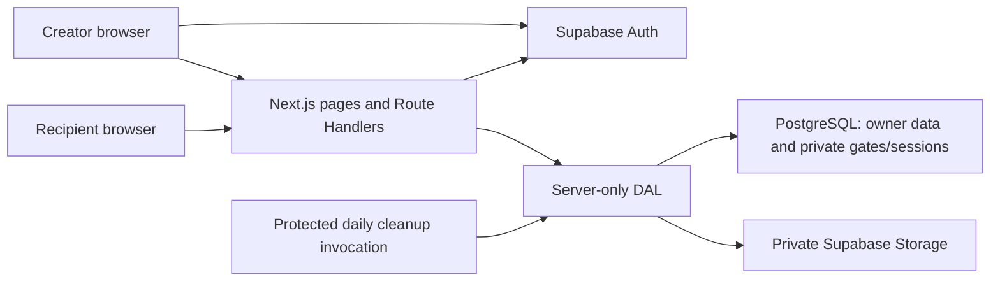
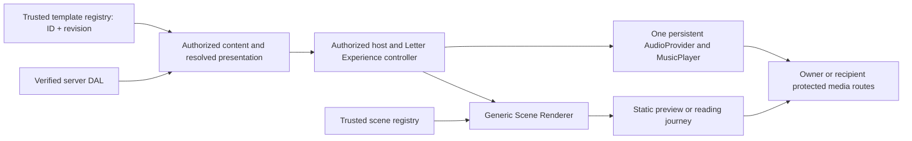

# SecretLove — Approved Architecture

G3 status (2026-10-16): the owner approved the G2 scope and local access/report/operator/privacy/public-mode code has been added. [G3 implementation](G3_PUBLIC_RELEASE_IMPLEMENTATION.md) records actual DAL/RLS/RPC coverage and verification limits; [G4 preparation](G4_CONFIGURATION_PREPARATION.md) is a separately approved next phase. Migration 009 has not been applied remotely. New Production backend binding remains deliberately null/fail-closed. Existing scenes/private streaming are preserved. G2 proposal language below is historical, not hosted acceptance evidence.

## Historical G2 public-release design baseline

Keep the existing Next.js/DAL/Supabase architecture and renderer. The reviewed-source proposal is [G2_PUBLIC_PRODUCTION_DESIGN.md](G2_PUBLIC_PRODUCTION_DESIGN.md): separate authenticated identity, approved Creator and MFA/registry-authorized operator; enforce approval in owner RLS and every privileged gateway; enforce letter holds/approval before all recipient bootstrap/session/content/media paths. Missing approval denies; outage/missing schema fails closed. Close/recovery/cleanup stay separate so revoked Creator access cannot prevent legitimate account recovery or safe pending-upload cleanup.

Report intake and a small protected operator surface are proposed, with atomic audited hold/reinstatement and no automatic publication/session restoration. Public-mode binding must identify the separately approved Production backend; Vercel All Deployments remains during hosted acceptance and Standard is a later public-opening action. No new app/SQL/dependency or remote configuration is made in G2. Core/Day 1.5 architecture approvals below do not mean these new controls are implemented. Branch-per-phase and pending product/provider inputs are in the G2 document.

Status: core and Day 1.5 approved; Creator Studio, recipient scenes, music and scene copy are implemented. The user additionally approved the bounded particle-heart/text-ring extension in section 13. Broader theme/background/animation editors and deployment remain outside scope. Current heart acceptance is in PARTICLE_HEART_TEST_REPORT.md and TASKS.md; older sections/reports remain historical.

## 1. Architecture decision

Use one Next.js App Router application on Vercel, with Supabase Auth, PostgreSQL, and a private Storage bucket. Next.js Route Handlers form the application API; a shared server-only data access layer (DAL) performs authorization, validation, and persistence. No separate backend, Redis, queue service, or ORM for the MVP.

Use TypeScript and Tailwind. Server Components provide the shell and authenticated initial Studio data. Client Components provide editor/forms, QR generation, Motion scenes, and a lazy-loaded React Three Fiber heart. Use the Node.js runtime for image processing and passphrase hashing.



All private photo upload/download bytes pass through the authorized server. The recipient never receives a Supabase JWT, a service key, a Storage object path, or a signed Storage URL. This keeps future requests revocable at the application boundary.

## 2. Boundaries and authorization

### Creator identity

Use `@supabase/ssr` browser/server clients and the version-appropriate token-refresh integration. Validate creator identity server-side with `getUser()` for protected Studio data and API calls; do not authorize from a cookie-decoded object or `getSession()` alone. Restrict confirmation/recovery redirects to the application's allowlist. The refresh layer is a convenience; each entry point enforces authorization. Supabase documents the distinction between validated identity and raw session reads in its [SSR guide](https://supabase.com/docs/guides/auth/server-side/creating-a-client).

Normal owner reads use the creator's JWT and RLS. Application mutations go through the DAL and restricted transactional RPCs, using a server-only service client. The DAL derives `actorId` from verified authentication; a transaction checks `letters.owner_id = actorId` again under a row lock. Clients cannot supply a trusted actor ID. Anonymous/authenticated roles have no direct table write grants, preventing REST calls from bypassing lifecycle rules or changing server-managed fields.

This is a deliberate MVP tradeoff: service access concentrates risk in the DAL, but avoids separate permissive client write paths. Test every privileged entry point. Private tables are outside the exposed Data API schemas. Narrow RPC gateways in the exposed schema are executable only by the service role; they use explicit grants and a fixed search path. Prefer SECURITY INVOKER where the service role already has required privileges; no publicly callable privileged functions.

### Recipient identity

The share URL locates a letter; it never authorizes content access. The generic landing/bootstrap reads only publication availability and the passphrase-required boolean. Verification creates a separate, opaque, database-backed recipient session bound to letter ID and access version. Every protected content/media request checks expiry, revocation, publication/deletion state, and version before fetching data.

Do not use a creator's authentication cookie as an automatic recipient bypass. Owner preview has its own owner-authorized route and shares only rendering components with the recipient experience.

### Disclosure and caching

The MVP unlocked content DTO contains only the display name, message document, template ID, and photo IDs/alt text. The future proposal in section 10 additionally returns validated presentation and opaque asset references after authorization only. Verification hashes, share records, owner IDs, storage paths, DOB, and internal timestamps are never included. Authorized content may be held in page memory; no localStorage, persisted query cache, offline service worker, or background preload before verification.

The one timestamp exception is the current recipient session's expiresAt, returned by the authorized content API so reload/resume can schedule expiry correctly. Generic Continue reading calls that protected API and falls back to verification if unauthorized; it never extends or creates a session. No private data is fetched into the initial landing shell.

Private pages/APIs/media are dynamic and use `Cache-Control: private, no-store`; no shared/static rendering, ISR, CDN caching, or Next Image optimization for private media. Render photos from authenticated same-origin proxy URLs using ordinary images. Apply generic metadata, noindex, no-referrer, and frame restrictions. Next.js requires authorization at each public server entry point; see its [authentication guidance](https://nextjs.org/docs/app/guides/authentication).

## 3. Proposed source layout

```text
src/app/
  (auth)/login, signup, recover, reset-password
  auth/callback/route.ts
  (studio)/studio/page.tsx
  (studio)/studio/letters/new/page.tsx
  (studio)/studio/letters/[id]/edit/page.tsx
  (studio)/studio/letters/[id]/preview/page.tsx
  l/[shareToken]/page.tsx
  api/letters/.../route.ts
  api/recipient/[shareToken]/.../route.ts
  api/internal/cleanup/route.ts
src/components/
  studio/     # editor, gallery controls, template selector, share panel
  recipient/  # verification and reading sequence
  scenes/     # envelope, heart, memories, letter; shared with preview
  ui/         # accessible buttons, inputs, notices
src/lib/
  supabase/   # browser, request-scoped server, server-only service clients
  server/     # identity, ownership, letters, verification, sessions, media, cleanup
  validation/ # shared schemas; authoritative checks still run server-side
  rich-text/  # strict document schema and safe React renderer
  templates/  # fixed rose/minimal presentation config
supabase/migrations/
tests/        # unit, integration/RLS, browser smoke scenarios
```

This is a proposed structure, not an instruction to create these folders before approval.

## 4. Data and transactional behavior

Detailed tables, constraints, grants, and indexes are in [DATABASE.md](DATABASE.md). API payloads are in [API.md](API.md).

- **Draft:** explicit Save; optimistic concurrency using `version`. No autosave conflict resolution.
- **Publish:** row lock; verify owner, expected version, non-empty message, configured gate, and ready photos. Generate 32 random bytes encoded base64url for the share token. Store raw token only in a private share table for owner retrieval; SHA-256 digest indexes lookup. Return the link to the owner. Freeze changes.
- **Unpublish:** one transaction sets draft, increments access/version counters, and deactivates the share link. Subsequent content and media requests fail, even if a session row still exists.
- **Republish:** generate a fresh token and increment access version; old links/QRs cannot locate an active share.
- **Verify:** rate-limit before costly work; read minimal gate/version, compare normalized identity digest and passphrase hash; then atomically recheck current publication/access version under the same letter lock used by mutations before inserting a session. A stale successful comparison cannot issue a valid session after revocation.
- **Delete:** one transaction marks deleted, clears message/recipient fields, removes gates/shares/sessions/photo metadata, and queues photo object paths for removal. Storage retries occur separately; tombstone remains until cleanup finishes. No creator undo in the MVP.
- **Concurrency:** transactions serialize on parent letter; transaction-scoped creator advisory locks serialize the 20-letter quota without modifying Supabase Auth rows. Studio serializes its own writes/uploads and preserves unsaved form input. Photo reservation/finalization/removal each increment version. Finalization compares the parent's current version to the server-issued post-reservation version; intervening changes cause a safe conflict and cleanup. Advance editor version only after an uninterrupted operation; do not mask another tab's edits by blindly adopting a later upload version. No multi-request transaction simulated in TypeScript.

## 5. Media pipeline

1. Owner sends one image as multipart data to the letter's photo endpoint; reject over-limit bodies and non-drafts before processing.
2. Validate signature and actual decode; allow non-animated JPEG/PNG/WebP only; enforce 4096 px per dimension and 16 megapixels; apply orientation, re-encode and strip metadata. Reject decode failures/unsupported input and normalized output over 3 MiB. Never serve original bytes; re-encoding discards appended/embedded non-image data without claiming universal polyglot detection. No original is retained.
3. Reserve a pending photo/available slot transactionally (slots 0–5) under the letter lock. Use a generated path `{ownerId}/{letterId}/{photoId}.webp`; ignore client file paths/names.
4. Upload normalized bytes to private Storage without upsert. Finalize metadata only if the letter is still active/draft, the reservation/path matches, and the post-reservation version is still current; otherwise remove the failed reservation and queue the object for cleanup.
5. Return success only for a ready photo. Pending uploads block publication. Failed/stale reservations and orphan objects are reconciled by cleanup; clients see a retryable error.
6. Owner and recipient image endpoints authorize each GET and stream bounded bytes from Storage; no redirect/signed URL or cacheable response.

The 3 MiB per-file ceiling provides room under Vercel's documented [4.5 MB Function request/response limit](https://vercel.com/docs/functions/limitations). Confirm total multipart size and output limits on the chosen deployment; users must compress oversized photos for the MVP.

Storage grants deny browser/anonymous object reads, writes, and listing. Only the server service client accesses the private bucket; database ownership and letter membership are checked first. Supabase distinguishes [private and public buckets](https://supabase.com/docs/guides/storage/buckets/fundamentals); public buckets are prohibited here.

## 6. Recipient scenes and editor

- One Client Component controls `locked → envelope → heart → gallery → letter`. Only `locked → unlocked` depends on server authorization; animation is presentation, never a security boundary.
- Use the same safe rich-text renderer and scene components for owner preview and recipients. Small editor (e.g. Tiptap core/StarterKit configured to allowlisted nodes) with only the MVP toolbar. Evaluate compatible stable packages when approved.
- Lazy-import Canvas/heart after access; procedural geometry, low polygon count, no postprocessing. Pause/stop rendering when hidden and unmount after the heart scene.
- Respect `prefers-reduced-motion`; use static CSS/SVG fallback and explicit navigation. Static envelope/heart assets are generic and can be public; uploaded photos cannot.
- Fetch content after verification or an explicit server-authorized resume; use returned expiresAt for the client timer and proxy media on demand. On 401/404 or expiry timer, clear content state and return to verification/unavailable view. Previously received bytes cannot be recalled.

## 7. Libraries and external setup

Required runtime packages: Next.js/React/TypeScript, Tailwind, Supabase JS + SSR, Motion, Three.js + R3F, a small structured editor, schema validation (Zod), local QR encoding, and Sharp for trusted image decode/re-encode. Node `crypto` supplies randomness, HMAC, hashes, and async scrypt. Do not add Zustand, an ORM, Redis, or separate workers unless approval changes scope.

Test tooling: one unit runner and a browser runner for important journeys; database access tests against an isolated real Supabase/local test instance. Pin mutually compatible stable versions and security patches during Day 1; no versions are assumed installed.

Environment proposal:

| Variable                               | Exposure/purpose                                                 |
| -------------------------------------- | ---------------------------------------------------------------- |
| `NEXT_PUBLIC_SUPABASE_URL`             | Public project URL                                               |
| `NEXT_PUBLIC_SUPABASE_PUBLISHABLE_KEY` | Public client key; grants/RLS must still deny private access     |
| `SUPABASE_SERVICE_ROLE_KEY`            | Server only; restricted DAL/Storage/RPC access                   |
| `VERIFICATION_HMAC_KEY`                | Server only; random 32+ bytes; protects name/DOB digest          |
| `RATE_LIMIT_HMAC_KEY`                  | Server only; separate random key for IP bucket identifiers       |
| `APP_ORIGIN`                           | Server canonical HTTPS origin for links, CSRF/redirect allowlist |
| `CRON_SECRET`                          | Server only; authenticate cleanup invocation                     |

No secrets in `NEXT_PUBLIC_*`, source, tests, URLs, or log output. Keep production and preview secrets/data separate. Keys are provisioned after approval, never as hardcoded examples.

External configuration owned by the user:

| Service            | Required setup before implementation/testing                                                                                                                                                                                                                                                                                                               |
| ------------------ | ---------------------------------------------------------------------------------------------------------------------------------------------------------------------------------------------------------------------------------------------------------------------------------------------------------------------------------------------------------- |
| Supabase           | Isolated non-production and production projects; chosen region; email/password provider with confirmation; explicit site/callback allowlist; public URL/publishable key and protected service key. Schema/private bucket creation follows approved migrations.                                                                                             |
| Transactional SMTP | SMTP host/port/credentials, verified sender, provider-required DNS (SPF/DKIM/DMARC), appropriate auth-email rate limits, and a confirmation/recovery delivery test. Supabase's default sender is restricted to project-team addresses and is not suitable for external-beta signup; see its [SMTP guide](https://supabase.com/docs/guides/auth/auth-smtp). |
| Vercel             | Approved project/plan and HTTPS origin, environment separation and secrets above, Node memory/runtime/payload budget, authenticated daily cron, and restricted operational/log access. Confirm provider plan eligibility for intended usage.                                                                                                               |
| Domain/DNS         | A stable app origin (initially a Vercel HTTPS hostname is sufficient) and a sender identity accepted by the SMTP provider. A custom website domain is optional; verified email delivery is required.                                                                                                                                                       |

QR generation, procedural 3D, rate limits, and cleanup storage use existing application/PostgreSQL capabilities; no QR vendor, 3D asset host, Redis, or separate queue subscription is required.

## 8. Operations and failure behavior

- Durable PostgreSQL counters provide atomic verification/general-request rate limits across Vercel instances; failures deny verification rather than disabling throttling.
- One protected daily cleanup route handles queued Storage deletions, stale pending uploads (>1 hour), expired/revoked sessions (>24 hours past expiry), and old rate buckets (>48 hours). A documented operator invocation can run the same job on demand. No cleanup credentials in query strings.
- Queue rows contain generated paths only. Bounded batches, retries/backoff, and stuck-job visibility via redacted operational logs; never claim physical deletion until success. Confirm scheduling support on the selected Vercel plan before release.
- Vercel's daily scheduler is best effort and does not automatically retry failed invocations. Persist jobs and reconciliation cursor, process until the runtime budget is reached, then continue on a later scheduled/operator run. Hobby cron permits daily execution with an invocation window; no deletion-time SLA is promised. See [cron plan limits](https://vercel.com/docs/cron-jobs/usage-and-pricing) and [delivery/error behavior](https://vercel.com/docs/cron-jobs/manage-cron-jobs).
- Logs record request ID, route template, status, duration, and safe error code; redact content, names, DOB, passphrases, cookies, and full share paths. Platform URL logs may still retain share tokens; treat this as a dependency risk.
- Supabase outage: real error state; no fake saves or sessions. Cleanup outage: access remains revoked; retry later. Image/3D failure: error/static fallback. Concurrent stale edit: 409 and reload prompt.
- Configure HTTPS, CSP (test editor/3D compatibility), frame denial, security headers, environment separation, and backup/recovery guidance. Operator-assisted account deletion queues photos before deleting the Auth user; automated account deletion is future scope.

## 9. Approval decisions and constraints

The proposed approval covers:

1. Single app/DAL with RLS owner reads, server-only writes/RPCs, private Storage, and media proxy delivery.
2. Low-security name/DOB matching plus optional scrypt passphrase, database sessions (30 minutes), and durable throttling.
3. Two templates, constrained rich text, six 3 MiB photos, and a procedural heart with static fallback.
4. Frozen published letters, Unpublish-before-edit, and fresh links on republish; no published snapshots.
5. Three implementation milestones after environment readiness, targeting three focused days. Review estimates 30–40 engineering hours; approve 1–2 days of contingency if needed, or explicitly revise scope for a strict 24-hour budget. Beta release remains gated on all acceptance/security checks. Deployment requires an approved target when reached.

User approval must be recorded in TASKS.md before application implementation. Any scope expansion requires revisiting the estimate; security gates cannot be waived by reducing visual scope.

Final coverage, review findings, and unresolved approvals are recorded in [ARCHITECTURE_REVIEW.md](ARCHITECTURE_REVIEW.md). A reviewed design does not establish that these controls have been implemented or tested.

## 10. Future customization and Scene Renderer proposal

**Historical Day 1.5 design, 2026-10-14; approved before Day 2.** The original planning task changed documentation only. The later user instruction authorizes the full recipient journey, including scenes previously planned for Day 3. Current implementation uses in-memory V1 legacy settings, a trusted two-template registry, typed scenes and one experience-level lifecycle controller. Motion/R3F/Three and local QR generation are now installed. JSON persistence, editable customization, AudioProvider/music uploads, private background assets and custom closing content below remain proposals. No existing migration was edited; the separate 002 gateway migration was manually applied by the user.

### 10.1 Review of the working Creator Studio

| Current implementation                                                                                                  | Extension implication                                                                                                                                                                                     |
| ----------------------------------------------------------------------------------------------------------------------- | --------------------------------------------------------------------------------------------------------------------------------------------------------------------------------------------------------- |
| `src/lib/types.ts` and validation allow `rose` / `minimal`; PostgreSQL also has a two-value template check              | A registry alone does not add selectable database templates today. Broaden validation/constraints only in a later approved extension; keep both IDs stable.                                               |
| `getLetter` uses verified identity, owner-RLS view reads and private gate flags; writes use locked service-only RPCs    | Resolve config behind the same DAL. Configuration and asset changes use the same parent lock, draft rule and `expectedVersion`, not a second permissive write API.                                        |
| `body_doc` is allowlisted rich-text JSON                                                                                | Keep message content separate from presentation. Reuse `RichText`; configuration must not enable HTML, styles or new message nodes.                                                                       |
| Client `LetterEditor` serializes Save/uploads and preserves unsaved input; current strict schemas reject unknown fields | Future config is explicitly versioned/validated. Current Save remains unchanged; clients cannot start sending new fields until server contracts are implemented. Preserve the fixed dirty-state behavior. |
| Preview page branches on template ID and renders saved greeting/message/photos in one static view                       | Replace this branch with trusted template definitions only during approved work, using parity tests. Do not turn the current owner preview into a forced animated journey.                                |
| Private `letter-media` bucket permits only normalized WebP; photo RPCs/path lookup/range behavior are photo-specific    | Do not put MP3s in this bucket or silently generalize photo upload/download. New asset types need their own validation and authorized delivery.                                                           |
| Cleanup jobs have only an object path; scanning recognizes `letter_photos` in one fixed bucket                          | New backgrounds in that bucket could be mistaken for orphans. Add bucket-aware jobs/scans and asset reference checks in a future migration before uploading new asset types.                              |

Reusable boundaries: verified identity/RLS, locked DAL writes, structured rich text, version conflict handling, private media authorization and durable cleanup. Missing future pieces: configuration resolver, template/scene registries, authorized asset abstraction and a reader-level audio controller.

The read-only Supabase Data API metadata inspection for this planning revision confirms `letters` has the existing content/template/status/version columns, `letter_photos` has the current image fields, and `creator_letters` has the current owner DTO columns. None has presentation, audio or final-message fields. CHECK constraints/private-schema definitions are inspected from the already-applied SQL source, because API metadata does not enumerate those controls. No rows or credentials were displayed and no database changes were made.

### 10.2 Versioned JSON and defaults

Keep three concepts separate:

1. **Content:** existing greeting, `body_doc` and ordered photo records; a future nullable `final_message_doc` holds an optional short closing message. Closing text never belongs in theme/scene options.
2. **Template identity:** existing `template_id`, plus a future pinned `template_revision` (implicit 1 for Day 1 rows).
3. **Presentation overrides:** a future nullable `presentation_config` JSONB document with its own `schemaVersion`. Neither schema version nor template revision replaces the existing concurrency `version` or authorization `access_version`.

Proposed stored JSON example, including future feature settings:

```json
{
  "schemaVersion": 1,
  "theme": {
    "colors": {
      "primary": "#963b58",
      "background": "#fcf8f5",
      "surface": "#fff2f4",
      "text": "#46242e",
      "mutedText": "#78616b"
    },
    "typography": { "headingFontId": "classic-serif", "bodyFontId": "system-sans" },
    "layout": { "presetId": "centered-letter", "contentWidth": "comfortable" },
    "decorativeEffects": { "presetId": "none", "intensity": 0 },
    "background": {
      "kind": "gradient",
      "angle": 135,
      "colors": ["#fff2f4", "#fcf8f5"]
    }
  },
  "music": {
    "enabled": false,
    "assetId": null,
    "loop": false,
    "defaultVolume": 0.35,
    "startPolicy": "manual"
  },
  "sceneOverrides": [
    {
      "slotId": "heart",
      "kind": "heart",
      "options": { "presetId": "pink-heart", "pacing": "gentle", "scale": 1 }
    }
  ]
}
```

`enabled` controls whether music is offered; it is independent of attachment. Disabled music may retain one ready track for later re-enabling but must not trigger recipient media resolution, fetching or playback. Enabling requires a non-null ready same-letter audio UUID. Detach explicitly sets `enabled: false` and `assetId: null`; toggling off keeps the reference, volume and loop preference. Creator preview requires the same owner authorization and an explicit Preview/Play gesture; it may audition an attached track without changing the saved enable flag. Image backgrounds use `{ "kind": "image", "assetId": "<validated UUID>", "fit": "cover", "scrimOpacity": 0.5 }` with an opaque validated text surface; solid backgrounds use `{ "kind": "solid", "color": "#fcf8f5" }`. These variants are a discriminated union, not arbitrary CSS objects. Templates and filenames/paths/URLs are not duplicated in stored JSON. This replaces the earlier unimplemented V1 draft naming (`accent`/`initialVolume`); no stored Day 1 configuration needs conversion.

Read resolution: strict schema validation → exact template ID/revision lookup → immutable template defaults → allowlisted overrides → accessibility/device constraints → resolved presentation. Merge known typed slots only. An omitted slot inherits its template default; music defaults to `enabled: false`, `assetId: null`, looping false, manual start and default volume 0.35. `primary` maps the existing accent role; `background` controls the authorized experience canvas, never the Studio or locked landing chrome. Unknown configuration fields are rejected on writes, not silently ignored. A small supported preset can have fewer editable capabilities without changing the generic schema.

Background precedence is explicit: resolve the canvas color token first. If only `theme.colors.background` is overridden on a solid template, derive the solid backdrop from that token so the color change is visible. An explicit `theme.background` variant takes precedence as the backdrop; the canvas token remains the safe base/fallback underneath gradients/images. An omitted variant inherits a template's non-solid backdrop. A failed private background falls back to the canvas token, never an external URL. Letter surfaces and text contrast remain independent of the decorative backdrop.

Initial proposal limits:

- UTF-8 compact config JSON <=16 KiB, bounded shape, no arbitrary extension bags/recursive scene trees. Keep current 96 KiB mutation-body and rich-text limits.
- Color values: six-digit hex only, normalized by the server. Validate text/control contrast; text has an opaque surface rather than trying to infer contrast from every background pixel. Viewer focus and motion constraints cannot be disabled by a creator.
- Font IDs resolve to bundled mappings (`classic-serif` preserves Georgia/Times; `system-sans` preserves Arial/Helvetica). Later self-hosted fonts require reviewed licensing and a trusted registry entry; uploaded fonts/remote CSS are excluded.
- Gradient: exactly two colors, finite angle 0–360. Image scrim opacity is finite 0–1; scale and effect parameters have per-preset bounds (initial heart scale 0.75–1.25). No `url()`, SVG, HTML, expressions, arbitrary style/class maps, shader code or module URLs.
- `defaultVolume` is finite 0–1 and a suggestion; recipient choice wins. `startPolicy` only supports `manual` in this first audio design. Disabled tracks are still validated references, but never trigger recipient media requests.
- Layout/decorative effect IDs are trusted registries, not class/CSS strings. Initial presets: centered/wide letter with comfortable/compact width; none/petals at bounded 0–1 intensity. No effect can obscure text, focus or controls; device/reduced-motion constraints override intensity.
- Scene overrides are a maximum-eight discriminated array with unique registered slot IDs from the chosen template. Every kind/preset has a strict options schema; wrong-kind/unknown keys fail. JSON does not define scene order, visibility predicates, module paths or verification. MVP flow still reaches the main letter and skips an empty gallery.

Schema migration is an explicit pure transform such as V1→V2, performed only during an approved write/migration. Never rewrite rows on read. Missing/null config means the canonical pinned template's defaults; only Day 1 rows with no stored revision imply revision 1. Resetting presentation never changes template ID/revision. Corrupt/unsupported config falls back to a known static authorized letter view with a notice and no custom asset loading; the owner must use a supported editor to change config or publish it. Do not silently replace unsupported stored JSON on an unrelated Save.

### 10.3 Proposed typed contracts

Use existing TypeScript, React and Zod capabilities; no new library is needed to define these boundaries. Authoritative validation stays server-side; client validation is only usability. The interfaces describe a later implementation.

```typescript
type TemplateRef = { id: string; revision: number };
type SceneKind = 'envelope' | 'heart' | 'gallery' | 'letter' | 'final-message';
type FontId = string; // resolved by a trusted font registry
type HexColor = string; // runtime six-digit-hex validation, not a security claim

type Background =
  | { kind: 'solid'; color: HexColor }
  | { kind: 'gradient'; angle: number; colors: [HexColor, HexColor] }
  | { kind: 'image'; assetId: string; fit: 'cover' | 'contain'; scrimOpacity: number };

type SceneOptionsByKind = {
  envelope: { presetId: string; pacing: 'gentle' | 'normal' };
  heart: { presetId: string; pacing: 'gentle' | 'normal'; scale: number; color?: HexColor };
  gallery: { presetId: string; layout: 'grid' | 'carousel' };
  letter: { presetId: string; bodySpacing: 'standard' | 'relaxed' };
  'final-message': { presetId: string; alignment: 'center' | 'start' };
};

type SceneOverride = {
  [K in SceneKind]: { slotId: string; kind: K; options: Partial<SceneOptionsByKind[K]> };
}[SceneKind];

type SceneEditCapability = {
  [K in SceneKind]: { kind: K; keys: readonly (keyof SceneOptionsByKind[K])[] };
}[SceneKind];

type LetterConfigurationV1 = {
  schemaVersion: 1;
  theme?: {
    colors?: Partial<Record<'primary' | 'background' | 'surface' | 'text' | 'mutedText', HexColor>>;
    typography?: { headingFontId?: FontId; bodyFontId?: FontId };
    layout?: { presetId: string; contentWidth?: 'comfortable' | 'compact' };
    decorativeEffects?: { presetId: string; intensity?: number };
    background?: Background;
  };
  music?: {
    enabled: boolean;
    assetId: string | null;
    loop?: boolean;
    defaultVolume?: number;
    startPolicy?: 'manual';
  };
  sceneOverrides?: SceneOverride[]; // each slot/kind must match the trusted template
};

type SceneSpec = {
  [K in SceneKind]: {
    slotId: string;
    kind: K;
    visibility: 'always' | 'has-photos' | 'has-final-message';
    options: SceneOptionsByKind[K];
  };
}[SceneKind];

type ResolvedTheme = {
  colors: Record<'primary' | 'background' | 'surface' | 'text' | 'mutedText', HexColor>;
  typography: { headingFontId: FontId; bodyFontId: FontId };
  layout: { presetId: string; contentWidth: 'comfortable' | 'compact' };
  decorativeEffects: { presetId: string; intensity: number };
  background: Background;
};
type ResolvedPresentation = {
  schemaVersion: 1;
  template: TemplateRef;
  theme: ResolvedTheme;
  music: {
    enabled: boolean;
    assetId: string | null;
    loop: boolean;
    defaultVolume: number;
    startPolicy: 'manual';
  };
  scenes: readonly SceneSpec[];
};

type AssetKind = 'photo' | 'background' | 'audio';
type AssetRef<K extends AssetKind = AssetKind> = { id: string; kind: K };
type AuthorizedLetterView = {
  letterId: string; // protected identifier for lifecycle/membership; never an access capability
  recipientDisplayName: string | null;
  bodyDoc: RichTextDoc; // existing allowlist, unchanged
  finalMessageDoc: RichTextDoc | null; // optional protected content, not config
  photos: readonly { asset: AssetRef<'photo'>; altText: string }[]; // ready photos only
  presentation: ResolvedPresentation;
};
type MediaSource = { url: string; mimeType: 'image/webp' | 'audio/mpeg' };
interface AssetResolver {
  // Returns an application-controlled same-origin proxy URL. It does not authorize a request.
  source(ref: AssetRef): MediaSource;
}

type RenderCapabilities = {
  reducedMotion: boolean;
  webglAvailable: boolean;
  quality: 'low' | 'standard';
  volumeControl: 'element' | 'device';
};
type SceneEvent = { type: 'next' | 'back' | 'skip' | 'media-error' };
type SceneProps<K extends SceneKind> = {
  content: AuthorizedLetterView;
  theme: ResolvedTheme;
  options: SceneOptionsByKind[K];
  assets: AssetResolver;
  capabilities: RenderCapabilities;
  active: boolean;
  onEvent(event: SceneEvent): void;
};
interface SceneDefinition<K extends SceneKind> {
  kind: K;
  validateOptions(input: unknown): SceneOptionsByKind[K];
  load(): Promise<{ Component: React.ComponentType<SceneProps<K>> }>;
  StaticFallback: React.ComponentType<SceneProps<K>>;
}
interface TemplateDefinition {
  ref: TemplateRef;
  displayName: string;
  defaults: Omit<LetterConfigurationV1, 'sceneOverrides'>; // scenePlan owns scene defaults
  capabilities: {
    headingFonts: readonly FontId[];
    bodyFonts: readonly FontId[];
    layoutPresets: readonly string[];
    effectPresets: readonly string[];
    backgroundKinds: readonly Background['kind'][];
    scenePresetsBySlot: Readonly<Record<string, readonly string[]>>;
    editableSceneOptionsBySlot: Readonly<Record<string, SceneEditCapability>>;
    music: boolean;
    finalMessage: boolean;
  };
  scenePlan: readonly SceneSpec[];
  StaticPreview: React.ComponentType<SceneRendererProps>;
}
interface SceneRendererProps {
  content: AuthorizedLetterView;
  viewMode: 'static-preview' | 'journey';
  assets: AssetResolver;
  capabilities: RenderCapabilities;
  expiresAt: string | null; // recipient expiry; owner host monitors creator access separately
  onAccessLost(): void;
}
type MusicState = {
  status: 'idle' | 'loading' | 'playing' | 'paused' | 'error';
  volume: number;
  muted: boolean;
};
interface MusicControllerProps {
  music: ResolvedPresentation['music'];
  assets: AssetResolver;
  volumeControl: RenderCapabilities['volumeControl'];
  active: boolean; // a client lifecycle signal; never server authorization
  onMediaError(): void; // host revalidates access; optional errors cannot trap reading
}
```

The `string` fields represent registries, not free-form permissions: runtime validation rejects a slot, template, font or preset absent from the selected trusted definition. Each discriminated override uses its slot's specific kind schema; a heart option cannot target a letter slot. Scene registry dispatch retains this relationship between `kind`, validated options and component props. Use `z.infer`/`z.output` from the schemas in section 10.8 as the eventual source of DTO types; the interfaces here describe the contract.

Capabilities are trusted revisioned data too. Adding editable settings to a frozen legacy definition creates a new revision; the creator explicitly opts into that revision when upgrading. Day 1 rows with no stored revision stay on legacy revision 1; null config on an explicitly upgraded letter uses its pinned revision's defaults. The controller keys resources by the protected letter ID and host generation; the owner/recipient host retains its URL locator outside scene content.

A kind schema describes all planned options, not which phase permits editing them. The server intersects installed capabilities with enabled milestone features and rejects unauthorized option keys. P1 accepts no nonempty `sceneOverrides`; heart scale/color/pacing become writable only in an approved P3 revision/rollout. P2 gates audio/image backgrounds similarly. Hiding a control in the editor is insufficient.

The DAL returns validated data only after authorizing the owner or letter-bound recipient session. `viewMode`, client capability flags, an asset ID and TypeScript types confer no authorization. Owner and recipient hosts build different proxy URL resolvers; server routes independently check the relevant identity and letter/asset membership. No actor ID, service client, storage path, session token or verification credential enters the renderer.

### 10.4 Registries and scene lifecycle



- Registry definitions are trusted application code/data, keyed by `id@revision`. They cannot be fetched from user URLs, evaluated, or import a module name supplied in JSON. No remote template marketplace/admin editor is needed.
- Register `rose@1` and `minimal@1` with exact Day 1 defaults and static preview composition. Freeze their definitions; changed defaults become a new revision. Omit music and creator scene overrides for legacy rows.
- Adding a template composed from registered primitives requires a definition, one registry entry, matching validation/capability metadata and parity/accessibility tests. It does not require editing the generic renderer. A genuinely new effect/layout can add a registered component and expand the kind/options types and schemas without changing generic renderer orchestration; custom creator code is excluded.
- The verification/locked host is outside the configurable scene plan. Only an authorized host mounts the presentation. It owns session expiry, close/revocation, media revalidation and navigation; a scene cannot unlock content or extend expiry.
- Journey controller handles Next/Back/Skip and focus once; optional scenes never trap reading. The final letter remains reachable, and a missing gallery is skipped. Keep static owner preview as a separate supported composition.
- Future authored `final-message` content follows the main letter and comes from protected `finalMessageDoc`, never options. The newly authorized Day 2 flow explicitly includes a generic closing/replay scene for legacy letters; it adds no stored content or rewrite to Day 1 letters. A future nullable authored closing document can replace this generic copy after P1 approval. New scene kinds extend schemas/types/registry entries, not host authorization or navigation lifecycle.
- Load expensive scenes only after access and when entering/approaching that scene; use eager static fallbacks. Unmount/pause R3F when inactive. Reduced motion and quality budgets override creator preferences.
- Unknown definitions or optional media failure show a safe generic/static authorized view. On a media error, revalidate the current protected access; if access is lost, clear all content and audio. A confirmed optional media failure leaves the readable letter available. Do not infer HTTP authorization status solely from an HTML media element's generic error.

### 10.5 Music controller and secure delivery — post-MVP

Use one `AudioProvider` around the unlocked experience and one `MusicPlayer` controls component. The provider owns one native `HTMLAudioElement` outside changing scenes. It starts stopped, uses `preload="none"`, and receives its source only after authorization, enabled music and an explicit Play action. Scene transitions do not create duplicate players or restart the track. A disabled attached track is not fetched. Owner-authorized explicit Preview can audition that track without changing the stored flag; it uses the owner proxy and never a recipient-session bypass.

Keep playing/paused/loading/error, current volume and mute state in provider memory, separate from saved config. Apply `defaultVolume` once per attached track/experience generation; recipient volume/mute choices win through subsequent scene changes. Set looping from saved `loop`; off ends playback and updates state, on repeats the same authorized track. Update control labels from media events and the `play()` result, not an optimistic button toggle. `MusicPlayer` invokes provider play/resume/pause/setVolume/mute actions; no scene creates a second audio element. On close, expiry, unmount, access loss or letter change: pause, remove source, call media reset and remove event listeners; abort in-flight work and discard late callbacks by generation. Reading works without audio.

Audible autoplay can be restricted by browser policy, and `play()` can reject; manual Play and truthful error/state handling are required. See [Chrome autoplay guidance](https://developer.chrome.com/blog/autoplay/). The [HTML media standard](https://html.spec.whatwg.org/multipage/media.html#dom-media-volume) defines 0–1 volume and allows device/user-agent restrictions. Test actual audible volume on target mobile browsers; show native/device-volume guidance when element volume cannot be controlled. Uniform in-app volume on every target browser is not promised until a separate compatibility prototype succeeds.

Proposed first music scope: one private MP3 per letter, <=3 MiB and <=180 seconds, inspected server-side for actual supported format/duration and metadata before ready status. Browser duration and MIME/file extension are not trusted. Sharp cannot inspect MP3; selecting an approved bounded audio-inspection/metadata-removal approach and validating its runtime cost are prerequisites. No audio dependency/service is selected or installed now. Larger tracks, transcoding, streaming-provider URLs/embeds, playlists and public audio catalogs are deferred. Confirm rights to tracks/fonts/preset assets before release.

Future same-origin audio routes must support authorized HEAD and bounded GET/range delivery: full response 200, supported single range 206 with correct Content-Range/Length, invalid/unsatisfiable range 416. Verify access before exposing size/metadata/bytes, and on **every** request, including range/HEAD. Keep private no-store/nosniff/no-referrer, no public Storage redirects/signed URLs, and no permissive CORS. Range semantics follow [RFC 9110](https://www.rfc-editor.org/rfc/rfc9110.html#name-range-requests); test actual mobile playback/seeking against the chosen Storage/server transport. The existing photo endpoint intentionally rejects Range and is not changed by this plan.

Recipient asset gateways additionally enforce current published references: a background UUID must be selected by the current validated config, and an audio UUID must be attached **and enabled** there. Same-letter ready state alone is insufficient. Unsupported config, disabled/unattached audio and unselected backgrounds return no metadata/bytes even if the recipient knows the UUID. Owner audition follows separate owner/membership/ready checks and may explicitly preview a disabled attached track. This policy is server-side, not a promise made only by the resolver/player.

Reject cross-letter/wrong-kind/pending asset references; use generated paths and server-held bucket mapping. Per-user upload/request limits and aggregate storage quotas must include the new asset kinds. Adding future audio should narrowly add `media-src 'self'` to CSP, with no third-party sources. Do not attach custom fonts/music/backgrounds to the locked landing or preload them from metadata. Authorization stops subsequent delivery; already delivered/decoded audio can be retained and cannot be erased by revocation.

### 10.6 Necessary future database changes — proposal, no SQL applied

| Future change                                                                     | Purpose / compatibility                                                                                                                                                                                                                                                                                                                                                                                 |
| --------------------------------------------------------------------------------- | ------------------------------------------------------------------------------------------------------------------------------------------------------------------------------------------------------------------------------------------------------------------------------------------------------------------------------------------------------------------------------------------------------- |
| Nullable `letters.presentation_config jsonb`, no non-null/default backfill        | Store overrides/schemaVersion only. Null uses the canonical pinned template's defaults; no revision on a Day 1 row implies revision 1. Validate object shape/positive schema version/size in SQL; full typed validation in DAL/RPC.                                                                                                                                                                     |
| `letters.template_revision integer`, implicit/default 1 for legacy letters        | Pin immutable registry definitions. Keep `template_id` as the sole template ID; do not duplicate template identity in JSON.                                                                                                                                                                                                                                                                             |
| Nullable `letters.final_message_doc jsonb`, no default/backfill                   | Optional protected closing text for a future final-message scene. Reuse the rich-text allowlist plus <=4 KiB compact UTF-8 / <=500 visible characters; allow explicit null to clear and preserve on omission. Keep combined Save payload within 96 KiB.                                                                                                                                                 |
| Broaden the current two-ID template CHECK in a separate approved migration        | Permit bounded registry IDs; DAL accepts only installed ID/revision pairs. A DB template catalog is unnecessary for developer-authored templates initially.                                                                                                                                                                                                                                             |
| New `letter_assets` table                                                         | UUID PK; `letter_id` FK; kind (`background`/`audio`), pending/ready state, generated unique path, server-selected bucket, byte size, MIME, audio duration or image dimensions, timestamps and optional protected display label. Kind-specific constraints, one active slot per kind including pending, parent index and owner-read RLS; service-only writes. Existing photos remain in `letter_photos`. |
| New private `letter-assets` bucket                                                | Only validated background WebP/audio MP3; browser read/list/write denied, including restrictive policies. Keep existing image-only `letter-media` unchanged.                                                                                                                                                                                                                                            |
| Bucket-aware cleanup jobs and maintenance cursors                                 | Add an allowed bucket identifier with legacy default `letter-media`; unique cleanup key becomes `(bucket_id, object_path)`. Update existing enqueue-function conflict targets in the same future migration, preserving their HTTP/RPC signatures. Extend stale/orphan/lease/delete processing to new metadata/buckets before accepting new uploads. Preserve and test existing queued photo jobs.       |
| Extend owner view/DTO mapping and restricted Save/publish/delete/reservation RPCs | Add config/asset support behind existing owner/draft/version locks. New settings do not bypass the current write contract. Config and asset references are updated/checked transactionally.                                                                                                                                                                                                             |

JSON references have no automatic PostgreSQL foreign key: the locked Save/publish transaction must verify every referenced UUID (including a disabled attached track) belongs to the same letter, has the required kind and is ready/not deleted. Direct removal of a referenced asset returns `409 ASSET_IN_USE`. Explicit detach is one version-checked transaction: clear its presentation reference, remove its active metadata row and enqueue the object's bytes for cleanup, freeing the slot immediately while reporting physical removal pending. Music detach sets `enabled` false and `assetId` null; background detach chooses the safe canvas fallback. A provided full-config replacement/reset uses the same detach transaction for old references it removes. Toggling music off retains its reference/metadata and never queues cleanup. Removing an unreferenced ready asset or failed reservation also queues cleanup. Delete/tombstone clears stored config/final-message content and enqueues all photo/background/audio paths in the same transaction. New reservations/finalization follow the existing post-reservation version rule; preserve the current guards that keep failed/retried responses from enqueueing an already-finalized live asset.

The initial extension has one active slot of each new kind per letter, counting both pending and ready rows. Replacement is atomic detach-and-queue (or remove an unreferenced asset) → reserve/upload/finalize → attach, with version changes and retry cleanup visible to the editor. Do not temporarily create a second active track/background or overwrite the old object's bytes. A seamless replacement protocol can be designed later with explicit extra quota/transaction rules. Disabling an attached track is not detaching it and does not free its slot.

Schema expansion preserves existing view columns, order, types (especially string `version`), security-invoker behavior and grants; append future view columns only. Compact JSON limits need defensive JSONB SQL headroom for spacing: propose <=24 KiB stored presentation and <=6 KiB final-message JSONB, while application limits remain 16/4 KiB. Keep `body_doc` unchanged. Omitting config or final-message in a Save preserves it; explicit null resets presentation to the pinned template's defaults or clears the closing text after lock/validation, without changing template ID/revision. Resetting config detaches custom assets using the transaction above.

Future RLS/grants preserve owner SELECT and service-only writes; private Storage still has no browser grants. Recipient access remains via the DAL/session proxies, never anonymous SELECT. Published configs/assets are frozen, unpublish/edit/republish retains the approved access-version/link rotation semantics, and pending referenced assets block publish.

No initial migration is edited or replayed. Future work creates separately reviewed additive migrations and a staged deployment: expand schema without changing old reads → compatible server/DTO support behind disabled feature controls → registry/UI rollout → verify parity/isolation/cleanup → enable writes. New config can be null on all existing rows; no bulk content/template rewrite is needed. Before rollback, disable new writes and use a server that understands/preserves new fields; do not roll back to Day 1 cleanup code against active new assets.

Mixed-worker compatibility needs an explicit guard: keep legacy claim **and acknowledgement** gateways restricted to `letter-media` jobs, and introduce versioned service-only bucket-aware gateways for new jobs. The old worker must never receive a new-bucket path and incorrectly acknowledge a no-op removal from the photo bucket. New acknowledgement verifies job, internal bucket and lease token; never trust a client path/bucket. Preserve legacy maintenance cursor format and create distinct versioned per-bucket operation rows. Deploy/test these guards and updated scanning before enabling new uploads; allow old invocations to drain. Do not rely on deployment timing alone for job isolation.

Migration sequence is expand-first: add the defaulted bucket identifier and `(bucket_id, object_path)` uniqueness while retaining old path uniqueness; update **all** enqueue gateway definitions and their conflict targets compatibly in the same reviewed transaction, then retire the old index only when safe. Existing RPC signatures remain intact. Replacing the old unique constraint before updating `ON CONFLICT(object_path)` would break working Day 1 delete/upload/cleanup paths. Every new table/column/gateway requires RLS/grant review and synthetic regression tests; no migration file or SQL execution is produced by this planning task.

### 10.7 Compatibility and implementation order

Day 2 essentials proposed for later authorization:

1. Complete the outstanding Day 1 security/external acceptance items from DAY1_TEST_REPORT.md as appropriate; keep their results separate from future-feature tests.
2. Review a separate additive migration for any missing publish/share/session transactional gateways, then implement frozen publication/link rotation, verification/limits and protected content/photo/session lifecycle. No customization schema changes.
3. Introduce a pure legacy presentation adapter and trusted `rose@1`/`minimal@1` definitions only if small enough to fit the protected-flow milestone. No persisted config, generic asset table, audio package or migration is needed for this seam. Keep the static owner preview and saved content/appearance equivalent; derive recipient presentation only after authorization, with availability/passphrase requirement as the sole public bootstrap settings.
4. Connect creator sharing/QR and accessible recipient verification/basic reading hosts, then run race/revocation/isolation/legacy regressions. Full journey components and controller navigation remain Day 3; the AudioProvider is P2. TASKS.md gives ordered checkpoints. Extensibility must not delay or weaken access controls.

Post-MVP implementation phases:

- **P1 — visual customization and optional closing content:** approved additive config/revision/final-message/registry-validation migration, strict resolver, color/font/layout/effect/solid-gradient controls, preview/save parity, immutable additional template definitions.
- **P2 — private assets and music:** bucket-aware cleanup/asset schema first, image/audio inspection and resource/rights gates, versioned attach/detach, protected range delivery, one reader-level music controller and actual cross-browser playback/volume tests.
- **P3 — animation/3D options:** registered bounded presets/options, performance/reduced-motion enforcement, error/static fallbacks and creator preview parity. Uploaded models/shaders and arbitrary timelines require a separate design/estimate.

Backward-compatible request rules: omitting `presentationConfig` or `finalMessageDoc` preserves the stored field; explicit null is an intentional reset/clear. A provided config is a fully validated versioned replacement, not unrestricted JSON merge-patch. An unchanged `templateId` without `templateRevision` keeps the pinned revision. A legacy request switching to `rose`/`minimal` chooses revision 1 unless an explicit revision is supplied. Validate preserved overrides against the target definition; incompatible changes return an actionable error without partial writes or silently discarding overrides/music. The same template ID is never a reset request. Unsupported versions are marked read-only for configuration editing/publication rather than normalized to null and round-tripped by older clients.

Acceptance before any feature rollout: legacy fixtures render with the same content/layout/theme and no audio; older Save requests preserve config; a new template composed from registered components needs no renderer edit; unsupported config cannot execute/load arbitrary content; stale config/media writes are 409; published editing is denied; cross-owner/cross-letter assets, unauthorized range/HEAD and pre-unlock requests reveal nothing; media detach/delete preserves retry jobs and actual physical-removal evidence; all relevant existing/new tests, typecheck, lint and build pass. Budget/format/browser decisions remain proposals until the corresponding phase is explicitly approved.

### 10.8 Concrete Zod schema proposal

These schemas are documentation examples for the installed Zod 4 API, not new production validators. They establish bounded shape; registry membership, color contrast, access and asset readiness require a second authoritative server pass under the existing lock. Use the same schemas for editor feedback, but never trust client validation. See [Zod schema API](https://zod.dev/api).

```typescript
import { z } from 'zod';

const RegistryId = z.string().regex(/^[a-z][a-z0-9-]{0,47}$/);
const Color = z
  .string()
  .regex(/^#[0-9a-fA-F]{6}$/)
  .transform((value) => value.toLowerCase());
const Unit = z.number().finite().min(0).max(1);
const Pacing = z.enum(['gentle', 'normal']);
const TemplateRefSchema = z.strictObject({
  id: RegistryId,
  revision: z.number().int().min(1).max(2147483647),
});
const BackgroundSchema = z.discriminatedUnion('kind', [
  z.strictObject({ kind: z.literal('solid'), color: Color }),
  z.strictObject({
    kind: z.literal('gradient'),
    angle: z.number().finite().min(0).max(360),
    colors: z.tuple([Color, Color]),
  }),
  z.strictObject({
    kind: z.literal('image'),
    assetId: z.uuid(),
    fit: z.enum(['cover', 'contain']),
    scrimOpacity: Unit,
  }),
]);
const ThemeSchema = z.strictObject({
  colors: z
    .strictObject({
      primary: Color.optional(),
      background: Color.optional(),
      surface: Color.optional(),
      text: Color.optional(),
      mutedText: Color.optional(),
    })
    .optional(),
  typography: z
    .strictObject({
      headingFontId: RegistryId.optional(),
      bodyFontId: RegistryId.optional(),
    })
    .optional(),
  background: BackgroundSchema.optional(),
  layout: z
    .strictObject({
      presetId: RegistryId,
      contentWidth: z.enum(['comfortable', 'compact']).optional(),
    })
    .optional(),
  decorativeEffects: z
    .strictObject({ presetId: RegistryId, intensity: Unit.optional() })
    .optional(),
});
const MusicSchema = z
  .strictObject({
    enabled: z.boolean(),
    assetId: z.uuid().nullable(),
    defaultVolume: Unit.default(0.35),
    loop: z.boolean().default(false),
    startPolicy: z.literal('manual').default('manual'),
  })
  .superRefine((music, context) => {
    if (music.enabled && music.assetId === null)
      context.addIssue({
        code: 'custom',
        path: ['assetId'],
        message: 'Attach a ready track before enabling music.',
      });
  });
const EnvelopeOptions = z.strictObject({ presetId: RegistryId, pacing: Pacing });
const HeartOptions = z.strictObject({
  presetId: RegistryId,
  pacing: Pacing,
  scale: z.number().finite().min(0.75).max(1.25),
  color: Color.optional(),
});
const GalleryOptions = z.strictObject({
  presetId: RegistryId,
  layout: z.enum(['grid', 'carousel']),
});
const LetterOptions = z.strictObject({
  presetId: RegistryId,
  bodySpacing: z.enum(['standard', 'relaxed']),
});
const FinalOptions = z.strictObject({
  presetId: RegistryId,
  alignment: z.enum(['center', 'start']),
});
const SceneOverrideSchema = z.discriminatedUnion('kind', [
  z.strictObject({
    slotId: RegistryId,
    kind: z.literal('envelope'),
    options: EnvelopeOptions.partial(),
  }),
  z.strictObject({ slotId: RegistryId, kind: z.literal('heart'), options: HeartOptions.partial() }),
  z.strictObject({
    slotId: RegistryId,
    kind: z.literal('gallery'),
    options: GalleryOptions.partial(),
  }),
  z.strictObject({
    slotId: RegistryId,
    kind: z.literal('letter'),
    options: LetterOptions.partial(),
  }),
  z.strictObject({
    slotId: RegistryId,
    kind: z.literal('final-message'),
    options: FinalOptions.partial(),
  }),
]);
const LetterConfigurationV1Schema = z
  .strictObject({
    schemaVersion: z.literal(1),
    theme: ThemeSchema.optional(),
    music: MusicSchema.optional(),
    sceneOverrides: z.array(SceneOverrideSchema).max(8).optional(),
  })
  .superRefine((config, context) => {
    const slots = config.sceneOverrides?.map((scene) => scene.slotId) ?? [];
    if (new Set(slots).size !== slots.length)
      context.addIssue({
        code: 'custom',
        path: ['sceneOverrides'],
        message: 'Scene slots must be unique.',
      });
    if (new TextEncoder().encode(JSON.stringify(config)).length > 16384)
      context.addIssue({ code: 'custom', message: 'Presentation configuration exceeds 16 KiB.' });
  });
type ConfigurationInput = z.input<typeof LetterConfigurationV1Schema>;
type ValidatedConfiguration = z.output<typeof LetterConfigurationV1Schema>;
```

Validation sequence: cap request bytes at 96 KiB before JSON parse → reject non-object/unsupported `schemaVersion` writes → shape parse → resolve exact installed template ID/revision → enforce its allowed fonts/layout/effect/preset capabilities and enabled phase → match each unique override's slot/kind and editable option keys → merge known defaults and validate complete options → verify contrast/resource bounds → under the parent lock verify ownership/draft/version and all asset UUIDs/kinds/readiness → save atomically. Disabled references still receive the ownership/readiness checks. Unknown future versions return a supported-editor error for config writes/publication; authorized reading may use the generic no-custom-media fallback.

Final-message content uses the existing `parseRichText` structure allowlist and an additional wrapper enforcing <=4 KiB compact UTF-8 and <=500 visible Unicode code points. The wrapper counts text leaves only, accepts no HTML/URLs and treats empty content as no final message. Proposed composition with the existing validator:

```typescript
import { parseRichText, messageText } from '@/lib/validation/rich-text';
import type { RichTextDoc, RichTextNode } from '@/lib/types';

const utf8Size = (doc: RichTextDoc) => new TextEncoder().encode(JSON.stringify(doc)).length;
const visibleCodePointCount = (node: RichTextDoc | RichTextNode): number =>
  node.type === 'text'
    ? [...(node.text ?? '')].length
    : (node.content ?? []).reduce((count, child) => count + visibleCodePointCount(child), 0);
const FinalMessageSchema = z.unknown().transform((input, context) => {
  try {
    const doc = parseRichText(input);
    if (utf8Size(doc) > 4096 || visibleCodePointCount(doc) > 500) {
      context.addIssue({ code: 'custom', message: 'Final message exceeds its limit.' });
      return z.NEVER;
    }
    return messageText(doc).length === 0 ? null : doc;
  } catch {
    context.addIssue({ code: 'custom', message: 'Invalid final message.' });
    return z.NEVER;
  }
});
const FutureSaveFields = z.strictObject({
  presentationConfig: LetterConfigurationV1Schema.nullable().optional(),
  finalMessageDoc: FinalMessageSchema.nullable().optional(),
});
```

These are proposed validators, not production success stubs. Integrate these fields into the existing strict Save schema; the isolated `FutureSaveFields` snippet is not a second write endpoint. Cap the full request before parsing, count Unicode code points in validated text leaves and retain existing depth/node/mark rules. Omitted fields preserve storage; explicit null resets/clears. Template choice remains separate. No presentation input can set actor/status/access/session versions, Storage paths or privileged callback handlers.

### 10.9 Global Letter Experience controller

One `LetterExperienceProvider` sits above the current scene and the optional `AudioProvider`. It owns authenticated access state, current slot, safe navigation, focus, device/reduced-motion capability overrides and resource lifecycle. It takes a DTO from the verified host; it does not perform client-only authorization. Owner preview uses verified creator routes; recipient mode uses a valid fixed-expiry session and published/share/access-version checks. Keep locked verification outside the scene registry and keep creator preview static by default.

```typescript
type ExperienceHost =
  { audience: 'recipient'; expiresAt: string } | { audience: 'creator'; expiresAt: null };
type ExperienceState =
  | { phase: 'locked' | 'loading' | 'unavailable' | 'expired' | 'closed' }
  | { phase: 'active'; generation: number; currentSlotId: string; content: AuthorizedLetterView };
interface LetterExperienceController {
  state: ExperienceState;
  next(): void;
  back(): void;
  skip(): void;
  close(): Promise<void>;
  revalidateAccess(): Promise<void>;
}
type SceneRegistry = { [K in SceneKind]: SceneDefinition<K> };
interface TemplateRegistry {
  get(ref: TemplateRef): TemplateDefinition | undefined;
}
interface AudioContextValue {
  state: MusicState;
  volumeControl: 'element' | 'device';
  play(): Promise<void>;
  pause(): void;
  resume(): Promise<void>;
  setVolume(value: number): void;
  setMuted(value: boolean): void;
}
```

Trusted template plans supply order and visibility from a small enum; no expressions/functions from JSON. Filter optional empty-gallery/final-message slots, keep the mandatory main letter reachable and navigate by stable slot ID. Bound the plan to eight scenes for the initial extension; adding a new registered kind extends its schema/type mapping without a new recipient host or audio lifecycle. Scene completion is an event, never proof of access. Final-message is optional after the main letter; its presence/content stays protected.

State transitions: locked → loading → active only after verified content; verification failure returns to locked; 401 triggers locked/expired as appropriate, 404 unavailable, explicit close closed. A transient optional media/module failure uses a fallback after protected-access revalidation; a failed revalidation pauses media and exposes no new content. Recipient close attempts server session revocation and immediately clears local content/audio regardless of network outcome; a failed remote revoke is reported and is not falsely claimed successful. Owner close/unmount tears down preview resources but does not revoke an unrelated recipient session.

Increment an experience generation on letter/host changes, expiry, close or access loss; abort outstanding fetches/revalidations and ignore callbacks from older generations. Timers use server-returned fixed expiry and never renew it. Revalidate on resume/visibility return or media failure; a paused timer/background tab cannot prolong access. Native media errors do not reveal their HTTP status reliably, so host revalidation determines whether all content is cleared or only an optional track becomes unavailable.

Mount the audio provider once per authorized letter generation, not per scene/slot; scene navigation updates only the scene child. Player state remains paused/playing at the same time with the recipient's volume/mute selection when Next/Back/Skip changes scenes. On attached-track replacement, stop/release the old track and require a fresh Play gesture for the replacement. Scenes cannot force-play, replace sources or override recipient volume. Native/provider promises/events update UI, including rejected Play and ended playback when looping is off. No localStorage/sessionStorage audio or letter state, global cross-letter singleton, hidden iframe or third-party streaming SDK.

Proposed composition (not added to source): `AuthorizedHost → LetterExperienceProvider → AudioProvider → {SceneRenderer, MusicPlayer}`. The static owner preview uses the same validated content/template/theme resolver and optional explicit music preview, without inheriting a recipient cookie or mounting unnecessary animated scenes.

## 11. Implemented background music extension

The original music request authorizes music separately from broader P2 customization. Migration 003 adds nullable `letters.presentation_config`, owner-readable `letter_assets` (one pending/ready audio slot per letter), private `letter-assets` MP3 bucket, bucket-aware retry jobs and service-only asset gateways. The existing photo bucket stays WebP-only. No backfill: null/unknown config resolves to silent legacy defaults; old Save requests preserve stored config. Themes, background assets and arbitrary scene overrides remain unavailable; the later explicit scene-copy request is implemented in section 12.

```json
{
  "schemaVersion": 1,
  "music": {
    "enabled": true,
    "assetId": "11111111-1111-4111-8111-111111111111",
    "defaultVolume": 0.35,
    "loop": false,
    "startPolicy": "manual"
  }
}
```

The strict V1 Zod music contract is reused by server validation, owner DTOs and recipient resolution. Only music-specific routes write this subset; no arbitrary config endpoint. Parent locks enforce verified owner, draft state, expected version and ready same-letter references. Upload reserves → private non-overwrite Storage upload → guarded finalize/attach (disabled initially). Disable retains attachment; explicit remove atomically clears it and queues bytes; replacement requires removal first. Publish rejects pending assets. Delete queues photos and audio while immediately revoking logical access. Ready-finalize retries/failure responses cannot enqueue a live asset.

`MusicSection` shares the editor mutation lock and version; unsaved music settings block publishing/preview and warn before leaving. It provides rights acknowledgement, upload/removal/settings and explicit owner audition, including disabled attachments. `MusicPlayer` is the equivalent global audio owner: it mounts once outside keyed scenes, holds one native audio element, assigns a same-origin source only on Play, applies configured volume/loop once and keeps recipient choices/time across navigation. Actual native events/play promises drive controls. Close/expiry/access loss unmount pauses/removes source/loads to release it; generation guards ignore late promises. Optional media errors revalidate access; valid readers continue, uncertain/lost access clears the whole experience.

Both owner and recipient GET/HEAD/range routes authorize before size/bytes/range validation. Recipient delivery additionally requires current enabled published selection and letter-bound session. Full/HEAD 200, one range 206 and malformed/unsatisfiable/multiple range 416; private no-store/nosniff/no-referrer throughout. Following the user's full-song request, audio downloads are bounded to 16 MiB, at most four concurrent transfers per server process; ranges currently slice a full bounded download. This simple transport costs extra egress on repeated seeks. No public/signed redirects or arbitrary external sources. CSP media-src is self only. The original photo cap remains 3 MiB.

The server-only `mpg123-decoder` dependency provides batch PCM inspection without a native binary/service. Strict Layer III framing, duration and byte limits precede decoding; ID3/APE file tags are stripped, frames decoded in batches of 32 and PCM discarded, sanitized framing reinspected. At most two inspections per process, eight-second processing budget. The user subsequently authorized 16 MiB/360-second full-song caps; migration 004 widens only audio metadata checks and the private bucket limit, preserving all existing rows and access controls. The 60 MiB aggregate quota remains unchanged. See FULL_SONG_AUDIO_SETUP.md for the manually completed rollout and passing isolated full-song checks. Larger uploads exceed Vercel Functions' documented request ceiling; compatible Node hosting or a separately approved private chunk/resumable transport is required before deployment. Real-device audibility/codec matrix and deployed resource costs remain release gates.

Cleanup uses v2 bucket/path/lease-bound claim/acknowledgement, independent resumable photo/audio scan cursors and stale reservation reconciliation. Legacy claims AND acknowledgements remain photo-only. Existing unique path/conflict targets are deliberately retained alongside a bucket/path index: generated .webp/.mp3 paths are disjoint, avoiding destructive constraint replacement or breaking old photo RPCs. Do not introduce overlapping bucket paths without a separate migration. Queued bytes count toward the 60 MiB creator audio quota; at most 100 queued audio jobs per creator. Deploy compatible server/worker before uploads and do not roll back to code unaware of audio.

## 12. Latest authorized soundtrack and scene-copy extension

The user explicitly authorized editable Heart/Closing copy and no recipient playback controls. Seven bounded plain-text fields live in nullable protected letters.scene_text, separate from presentation JSON. New migration 005 preserves old rows/view privileges/music; transactional Save handles optional sceneText with the existing owner/draft/version lock. Null uses exact legacy defaults; omission preserves previous customization. Registered scenes and saved owner preview render validated strings through React, preserving Unicode/newlines and wrapping long words. A deletion trigger clears the new content on tombstoning. Generic landing/bootstrap/metadata contain no custom text. See SCENE_TEXT_SETUP.md for the JSON contract. No arbitrary HTML/code, advanced scene editor or new dependencies.

The global MusicPlayer mounts only after a user-initiated unlock/resume returns authorized content and attempts the enabled track. Its background mode hides app/native controls; Creator preview remains manual and interactive. useImperativeHandle exposes only a blocked-start retry capability to the host; envelope/heart/navigation clicks can satisfy browser interaction requirements. NotAllowedError is reported honestly, without resetting valid access or repeated timer attempts. Source remains private; no audio before authorization. Scenes never own a player. Navigation preserves it; close/expiry/access loss releases it. Browser/OS can still silence/pause playback; no app can promise otherwise.

Stored V1 startPolicy=manual remains a compatibility marker for interaction-initiated gifts; the new request replaces the separate Play UI with unlock/open initiation. No policy backfill or JSON version change. Earlier section-11 separate-Play/control descriptions are historical and superseded for recipient UI by this extension. Default volume/loop, 16 MiB/360-second bounds, aggregate quotas and protected GET/HEAD/range remain unchanged. Vercel transport/device/deployed-resource gates still apply.


## 13. Approved particle heart and private text rings

The user authorized this separate Day 2 extension and original procedural geometry on feature/particle-heart-customization. Day 3 is not started. Actual reference: references/heart/particle-heart-reference.mp4, decoded 1920x1200, 5.802646s; extracted/inspected at 0.20, 2.00, 4.00 and 5.50s. Rounded pink point sculpture above white tilted orbits, black sparse starfield, gentle size variation and rotating text; no player overlays/watermark copied. No GLB/GLTF is used or downloaded.

Rendering remains lazy-loaded through the existing typed HeartScene registry entry. The recipient host retains authorization, generation/navigation and its one audio element outside keyed scenes. HeartScene is also used by the explicit unsaved Studio preview and saved owner preview; neither issues recipient sessions nor publishes. Other scenes keep their existing layout. Only the active heart changes the host to a full-width black cosmic stage with subdued headings/controls and no petals/roses.

An original implicit heart polynomial defines a rounded volume. Seeded rejection sampling fills the interior with a shell bias, stored once in Float32Array/BufferGeometry per device/configuration change. It is not a flat extruded outline or a visible solid mesh. One Points draw renders the heart; trusted soft alpha shader discs vary brightness/size using a time uniform; normal blending preserves the pink hue without additive white saturation. Heartbeat, float, entrance and pointer response transform the group, not every CPU particle. Stars and faint orbital dust use two more bounded Points draws. An invisible low-poly hit volume plus a labelled keyboard button reveal the existing protected message.

Text uses locally rasterized CanvasTexture glyph atlases, NFC plus Intl.Segmenter graphemes and system Arial/Helvetica with Vietnamese coverage. These are textures on real tangent-oriented instanced 3D planes around circular paths, not screen-space text. Glyph width measurements determine spacing; phrases repeat with a separator, bounded repetition count. Each ring has its own radius/height/inclination and slow/normal/fast angular velocity (0.10/0.18/0.28 radians/sec; alternating directions). Instancing gives one draw per ring. No new text/font/model dependency or remote resource. Glyph textures, meshes, geometries and materials are disposed on removal/unmount. Runtime/context failure retains static heart and literal phrases; reduced motion skips WebGL entirely. Static fallback color may use the established pink icon.

Initial bounded budgets are 11000 heart points at canvas width >=600 and 6000 below, 450/250 stars, 600/300 dust, DPR <=1.5, no post-processing. Portrait distance derives from actual canvas aspect ratio; camera remains fixed. Performance/visual comparison must be measured in the test report, not inferred from these limits. Headless timing is not physical-device performance.

Versioned configuration lives in existing protected presentation_config.heartCustomization (outer V1, inner V1; 4 KiB). Strict presets: procedural-particle, pink/red/purple, rings enabled, <=5 private 1–60 Unicode-code-point phrases, slow/normal/fast. Empty phrase array inherits three defaults; missing/null settings use defaults. The pure resolver does not write data. Unknown executable/URL/style fields fail writes; HTML-looking phrases are literal glyphs/React text. Registry/order/access remains trusted code. The heart appearance intentionally replaces the previous solid-heart renderer for legacy letters; legacy data/message/navigation/music remain compatible.

Save extends the existing owner/draft/version/Origin-limited API. Omitted heartCustomization preserves it; explicit null resets heart settings only. The editor shares dirty-state, lock, version and save normalization; on-demand unsaved preview stays local until Save. Published letters remain read-only. Migration 006 adds a validator/CHECK and merges heart changes into existing presentation JSON. It replaces music finalize/settings/remove with equivalent authorization/quota/race behavior and JSON merges, so those actions preserve heart settings. No new table/column/public route, no RLS/Storage change. Existing delete still clears presentation_config; protected recipient content already returns this field after letter-bound access checks. Apply only manually using PARTICLE_HEART_SETUP.md; migrations 001–005 remain unchanged.

References for implementation choices: [Three.js InstancedMesh](https://threejs.org/docs/pages/InstancedMesh.html), [CanvasTexture](https://threejs.org/docs/pages/CanvasTexture.html), [R3F performance](https://r3f.docs.pmnd.rs/advanced/scaling-performance).

## 14. Prompt 07 — approved private Preview transport

This supersedes section 11's buffered audio delivery and multipart hosting limitation. The owner approved same-origin <=1 MiB indexed chunks; manually applied 008 adds service-only private ingest/part tables and a private staging bucket. Studio begins with owner/draft/version/quota checks, transfers immutable parts, then commits only after server full-manifest verification and existing MP3 normalization. Sanitized ready audio uses the unchanged versioned music configuration. Pending ingests prevent publication; cancellation/expiry/delete queue raw/candidate bytes safely. The owner DTO exposes only pending status/ID/expiry, never Storage paths. Existing applied migrations are immutable.

Private audio GET streams directly from the authorized private upstream with normalized Range, validated metadata, backpressure, cancellation, lifetime concurrency and timeout bounds; no full-object response buffer, public bucket or signed redirect. New requests recheck current letter access. Already-started/delivered bytes may outlive revocation. The single recipient player and scene registry remain unchanged. Cleanup v3 adds staging without allowing legacy workers to consume its jobs. Product caps remain 16 MiB/360 seconds and the existing creator quota; no dependency added. Precise APIs, trade-offs and operational limits are in DEPLOYMENT.md.

Preview proposal is secretlove-preview, owner-only Vercel Authentication, existing isolated Supabase project and **exact HTTPS origin pending**. Preparation is authorized; deployment/project creation/remote configuration/public release/Prompt 08 are not. A prepared HTTPS target test does not certify Vercel compatibility until an approved target exists and execution passes. Policy/report/retention work is a separate internal plan with pending contact and provider verification.
