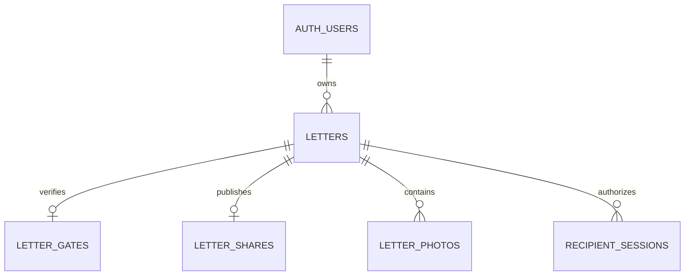

# SecretLove — Database Schema

G3 (2026-10-16): proposed controls below are now represented in `supabase/migrations/202610160009_public_release_controls.sql` and local PGlite tests. This is **NOT APPLIED remotely**. Empty private role registries, report/moderation/audit tables, approved-owner RLS and service-only replacements preserve migration history 001–008. The sole browser function exception is the authenticated current-user boolean RLS helper. [Coverage and test limitations](G3_PUBLIC_RELEASE_IMPLEMENTATION.md); [new-backend-only application/bootstrap packet](G4_CONFIGURATION_PREPARATION.md). Do not apply 009 to the historical isolated project or backfill its users.

## G2 proposed schema — NOT APPLIED

[G2_PUBLIC_PRODUCTION_DESIGN.md](G2_PUBLIC_PRODUCTION_DESIGN.md) specifies proposed private `creator_access`, `operator_accounts`, `abuse_reports`, `letter_moderation` and `operator_audit`, with RLS, no browser table grants, bounded retention and service-only transactional gateways. The sole proposed authenticated-executable helper is no-argument/current-user-only `sl_creator_is_active()` for owner RLS: reviewed SECURITY DEFINER, empty search_path, no private-schema grants or user-ID lookup. All other privileged gateways remain service-only. Approval/hold coverage must include functions that bypass `private.lock_letter`, and cleanup exceptions must remain termination-only.

Actual migration history remains 001–008. The next proposed 009 is **not created** in G2 and must be renumbered if history changes before G3. New production installation is 001–008 then reviewed 009; no automatic approval/backfill or remote application to the old test project. Bootstrap is separate exact-Owner-UUID permission, not a seeded account or public self-grant. Applying new approval RLS without explicit membership denies existing users by design; do not silently change the historical test project. Details, relationships, locks, grant exception, mutation/deletion semantics and acceptance cases are in the G2 proposal, not a claim of live schema readiness.

Status: migrations 001/002 provide Creator and recipient foundations. Additive migration 003 provides the authorized music extension and was manually applied and verified by the user in the isolated project. Applied migrations remain immutable. Current evidence/setup is in MUSIC_TEST_REPORT.md, MUSIC_SETUP.md and TASKS.md.

PostgreSQL is the source of truth. Use Supabase Auth's `auth.users`; no duplicate passwords, recipient accounts, profiles table, or generic permissions framework in the MVP. IDs are generated UUIDs; timestamps are UTC `timestamptz`. The migration has explicit table/function grants and a security-invoker `creator_letters` view with string versions.

## 1. Relationships

Rate-limit buckets and cleanup jobs are independent operational tables. Cleanup jobs must survive letter/photo deletion.

## 2. `public.letters`

| Column                     | Type/default            | Constraint/meaning                                                                            |
| -------------------------- | ----------------------- | --------------------------------------------------------------------------------------------- |
| `id`                       | `uuid`, generated       | Primary key                                                                                   |
| `owner_id`                 | `uuid`                  | NOT NULL FK `auth.users.id`; RESTRICT user deletion until operator cleanup                    |
| `title`                    | `text`                  | NOT NULL, trimmed 1–120 characters; private Studio title                                      |
| `recipient_display_name`   | `text`, nullable        | 1–100 trimmed characters when set; disclosed only after access                                |
| `body_doc`                 | `jsonb`, empty document | NOT NULL; validated rich-text document; not trusted HTML                                      |
| `template_id`              | `text`, `rose`          | CHECK in `rose`, `minimal`                                                                    |
| `status`                   | `text`, `draft`         | CHECK in `draft`, `published`                                                                 |
| `version`                  | `bigint`, 1             | Positive; increments on every successful logical change, including photo finalization/removal |
| `access_version`           | `bigint`, 1             | Positive; increments on publish/unpublish/delete and gate-affecting changes                   |
| `published_at`             | `timestamptz`, nullable | Populated only while currently published                                                      |
| `deleted_at`               | `timestamptz`, nullable | Tombstone denies access immediately; excluded from active-letter quota/list                   |
| `created_at`, `updated_at` | `timestamptz`, `now()`  | Server-managed; `updated_at` changes on logical mutation                                      |

Indexes: primary key; partial `(owner_id, updated_at DESC, id)` WHERE deleted_at IS NULL. CHECK positive counters, title/display-name length, status/template allowlists, and `status = 'published'` iff `published_at IS NOT NULL` for non-deleted rows. Tombstones are draft, publication cleared, display name NULL, body reset to empty. The DAL caps compact UTF-8 JSON at 64 KiB; a separate DB defensive cap of 96 KiB on UTF-8 `body_doc::text` allows for JSONB's different serialization/spacing. These are distinct measurements, not interchangeable limits.

Rich-text node/character/depth validation is authoritative in the DAL. Cross-table publication requirements are enforced in the transactional publish function, not an impossible cross-table CHECK constraint. No owner, status, or version value is accepted directly from a client as writable data.

## 3. `private.letter_gates`

| Column              | Type              | Constraint/meaning                                                                       |
| ------------------- | ----------------- | ---------------------------------------------------------------------------------------- |
| `letter_id`         | `uuid`            | PK/FK letters.id ON DELETE CASCADE; one gate per letter                                  |
| `identity_nonce`    | `bytea`           | NOT NULL, 16 random bytes; changes on gate replacement                                   |
| `identity_digest`   | `bytea`           | NOT NULL, 32-byte HMAC-SHA-256 of canonical name/DOB inputs                              |
| `hmac_key_version`  | `smallint`, 1     | Key identifier; no actual key stored in DB                                               |
| `passphrase_record` | `jsonb`, nullable | scrypt algorithm, N/r/p, random salt, derived hash and encoding version; never plaintext |
| `updated_at`        | `timestamptz`     | Server-managed                                                                           |

No plaintext verification name or DOB is retained. Recipient display name is separately stored in letters and may resemble the verification name; this is not full anonymity. Canonical input is JSON-encoded `[letterId, nonceBase64, normalizedName, dateString]`, avoiding ambiguous concatenation. UTF-8 bytes are HMACed with the server key. No fast unkeyed hash for low-entropy DOB.

An owner API returns only `verificationConfigured` and `passphraseRequired`. Gate updates require both name and DOB again; passphrase update/removal is explicit. HMAC key loss/retirement requires owner reconfiguration and session invalidation; it is not recoverable from the digest. Passphrase record parameters and byte lengths are strictly validated on reads.

Gate creation requires a complete name/DOB digest. A passphrase cannot create a gate row without identity fields: require an existing gate or complete verification in the same save transaction. Passphrase removal does not remove name/DOB verification. This preserves NOT NULL identity fields and avoids an undefined passphrase-only mode.

## 4. `private.letter_shares`

| Column         | Type          | Constraint/meaning                                              |
| -------------- | ------------- | --------------------------------------------------------------- |
| `letter_id`    | `uuid`        | PK/FK letters.id ON DELETE CASCADE                              |
| `token_digest` | `bytea`       | UNIQUE NOT NULL, 32-byte SHA-256 of raw token                   |
| `share_token`  | `text`        | NOT NULL; base64url encoding of 32 random bytes (43 characters) |
| `active`       | `boolean`     | NOT NULL; true only while published                             |
| `created_at`   | `timestamptz` | Current publication's creation time                             |

Hash enables indexed lookup. The raw bearer locator is intentionally retained only in this private table so an authenticated owner can retrieve the current share link on another device. It is confidential and excluded from normal letter/list/content DTOs. Do not claim hash-only storage for share tokens. A DB compromise exposes content and share links.

Unpublish deactivates this row. Republish replaces it with a new token/digest; the old token cannot locate a published letter. Deleted letters have no share row. No public letter ID enumeration or numeric short links.

## 5. `public.letter_photos`

| Column            | Type/default           | Constraint/meaning                                                       |
| ----------------- | ---------------------- | ------------------------------------------------------------------------ |
| `id`              | `uuid`, generated      | PK                                                                       |
| `letter_id`       | `uuid`                 | NOT NULL FK letters.id ON DELETE CASCADE                                 |
| `slot`            | `smallint`             | NOT NULL, 0–5; UNIQUE `(letter_id, slot)` limits concurrent reservations |
| `object_path`     | `text`                 | UNIQUE NOT NULL; generated `{ownerId}/{letterId}/{photoId}.webp`         |
| `status`          | `text`, `pending`      | CHECK `pending`, `ready`; pending is not recipient-visible               |
| `mime_type`       | `text`                 | NOT NULL, normalized `image/webp`                                        |
| `byte_size`       | `integer`              | NOT NULL, >0 and <=3,145,728 normalized bytes                            |
| `width`, `height` | `integer`              | >0, <=4096, product <=16,000,000                                         |
| `alt_text`        | `text`, `Photo memory` | NOT NULL, 1–200 characters                                               |
| `created_at`      | `timestamptz`, `now()` | Ordering by created_at, id; slot holes may be reused                     |

Index `(letter_id, created_at, id)`. Owner DTOs omit `object_path`; recipient DTOs include only ready IDs/alt text. Parent letter row lock controls reservation/finalization/deletion/publication; hard maximum six rows plus slot uniqueness. Ready status is set only after successful Storage write. No original filename or EXIF retained.

Reservation, ready finalization, and removal/failed-reservation cleanup each update the parent version. Reservation returns its new post-reservation version to the server upload handler. Finalization requires that parent version, ownership, draft state, and reservation/path still match under lock; otherwise it removes the failed reservation/queues any uploaded bytes and returns a conflict. Do not require the old pre-reservation version or blindly accept any newer version. Studio serializes its own writes and advances its editor version only after an uninterrupted operation; another tab's intervening Save cannot be silently overwritten by adopting an upload's latest version.

When rejecting a late/stale upload, return decision data after committing reservation cleanup/enqueue; the HTTP layer translates it to 409. Raising a SQL exception would roll back that cleanup and must not be used for this path. Never accept cleanup paths from the browser; the upload handler retains only its trusted generated reservation/path.

## 6. `private.recipient_sessions`

| Column           | Type/default            | Constraint/meaning                                           |
| ---------------- | ----------------------- | ------------------------------------------------------------ |
| `id`             | `uuid`, generated       | PK; internal                                                 |
| `letter_id`      | `uuid`                  | NOT NULL FK letters.id ON DELETE CASCADE                     |
| `token_digest`   | `bytea`                 | UNIQUE NOT NULL, 32-byte SHA-256                             |
| `access_version` | `bigint`                | NOT NULL; publication version authorized at issuance         |
| `created_at`     | `timestamptz`, `now()`  | Server time                                                  |
| `expires_at`     | `timestamptz`           | NOT NULL, created_at + 30 minutes; fixed, no sliding renewal |
| `revoked_at`     | `timestamptz`, nullable | Explicit Close/sign-out revocation                           |

CHECK positive version and expires_at > created_at. Index `(letter_id)` and `(expires_at)`; unique digest for lookup. Only the random raw session token goes in the cookie; never save it in DB/logs. On every read, join current non-deleted published letter, active share, and matching access_version; expiry checked against server time. A session does not authorize any other letter or creator endpoint.

## 7. `private.rate_limit_buckets`

| Column         | Type          | Constraint/meaning                                                 |
| -------------- | ------------- | ------------------------------------------------------------------ |
| `scope`        | `text`        | e.g. `verify_ip`, `verify_letter_ip`, `verify_letter`, `public_ip` |
| `key_digest`   | `bytea`       | 32-byte keyed digest; never store raw IP/name/DOB/share token      |
| `window_start` | `timestamptz` | Fixed-window boundary computed from DB clock                       |
| `attempts`     | `integer`     | Positive atomic count                                              |
| `expires_at`   | `timestamptz` | Cleanup bound                                                      |

Composite PK `(scope, key_digest, window_start)`; index expires_at. Restricted RPC checks/increments applicable scopes atomically; no application-memory limiter. Its global IP count is consumed before share lookup; known letters also consume letter scopes before gate comparison. Denials are returned as decision data, not SQL exceptions that roll back consumed counts. Unknown links still commit their global count. Fixed-window boundary bursts and distributed IP attacks remain acknowledged limitations.

## 8. `private.media_cleanup_jobs`

| Column            | Type/default            | Constraint/meaning                                            |
| ----------------- | ----------------------- | ------------------------------------------------------------- |
| `id`              | `uuid`, generated       | PK                                                            |
| `object_path`     | `text`                  | UNIQUE NOT NULL; fixed private bucket implied                 |
| `letter_id`       | `uuid`, nullable        | Diagnostic reference without FK so jobs survive hard deletion |
| `attempts`        | `integer`, 0            | Non-negative retry counter                                    |
| `available_at`    | `timestamptz`, `now()`  | Retry/backoff/lease availability                              |
| `lease_until`     | `timestamptz`, nullable | Prevent concurrent workers losing jobs                        |
| `last_error_code` | `text`, nullable        | Bounded internal code; no provider payload/secrets            |
| `created_at`      | `timestamptz`, `now()`  | Operational age                                               |

Index `(available_at)`; transactional enqueue with logical photo/letter deletion. Worker claims bounded batches using locks/leases; removes job only after confirmed deletion (already missing object is success). Retry transient failures with capped backoff; expose stuck-job counts operationally. Purge tombstone only after all its jobs complete.

## 9. `private.maintenance_state`

One service-only row per maintenance operation, keyed by `operation` (text primary key), with `cursor` (bounded jsonb or NULL), `last_success_at` (timestamptz or NULL), and `updated_at` (timestamptz). It persists bounded Storage-list sweep progress and last completed maintenance run across serverless invocations. No letter content, credentials, raw IPs, or user-supplied cursor is stored. Reset after a full sweep and periodically restart sweeps to reconcile pagination changes. Access/grants match other private operational tables; no browser API.

## 10. Grants, RLS, and Storage policy proposal

| Resource                       | `anon`                          | `authenticated`                                             | Server service role                                          |
| ------------------------------ | ------------------------------- | ----------------------------------------------------------- | ------------------------------------------------------------ |
| letters                        | No grants/policies              | SELECT own non-deleted rows only                            | Authorized reads/mutations through DAL                       |
| letter_photos                  | No grants/policies              | SELECT if parent owner is auth.uid() and parent not deleted | Authorized pipeline/media operations                         |
| private tables/schema          | No usage/access                 | No usage/access                                             | Explicit required privileges only; not an exposed API schema |
| Restricted public RPC gateways | No EXECUTE (also revoke PUBLIC) | No EXECUTE                                                  | Explicit per-function EXECUTE grants                         |
| Storage `letter-media` objects | No listing/read/write           | No listing/read/write                                       | Upload/download/delete after application authorization       |

Enable RLS on every proposed table, including private operational tables as defense in depth. RLS policies for owner reads use `auth.uid()` and parent ownership, not client metadata or UUID/path secrecy. No INSERT/UPDATE/DELETE grants or policies for browser roles. Service role bypasses RLS, so ownership and recipient checks are mandatory before privileged access; RLS alone cannot protect server mistakes.

Create `letter-media` as **private**, WebP-only normalized objects, maximum 3 MiB. No public buckets, blanket SELECT policies, or browser signed upload capability. See Supabase's [Storage access control](https://supabase.com/docs/guides/storage/security/access-control) and [function privilege guidance](https://supabase.com/docs/guides/database/functions).

## 11. Transaction/RPC responsibilities

Names below describe proposed contracts; signatures/migrations are implementation work after approval. All mutation functions take a DAL-derived actor ID where relevant, reject unowned/deleted targets, whitelist fields, and validate expected version. The delete operation may read an owned tombstone solely to return idempotent removal status. Gateway functions never trust browser-supplied identity.

| Operation                                              | Atomic responsibility                                                                                                                                                    |
| ------------------------------------------------------ | ------------------------------------------------------------------------------------------------------------------------------------------------------------------------ |
| `create_letter`                                        | Use a transaction-scoped creator advisory lock, check 20 active-letter quota, create default draft; do not modify/lock Supabase-managed auth rows                        |
| `save_letter`                                          | Lock parent, check owner/draft/version, persist validated fields/gate hashes, increment version and access_version when gate changes                                     |
| `publish_letter`                                       | Lock parent; validate complete draft/no pending photos; active fresh share and publication/version updates together; retry same published version without token rotation |
| `unpublish_letter`                                     | Lock parent; deactivate link, draft status, publication cleared, increment version/access_version; repeat on current draft is no-op                                      |
| `reserve_photo` / `finalize_photo`                     | Lock parent; draft/ownership/quota checks; no ready row without Storage success; late upload completion cannot resurrect deleted/published data                          |
| `update_photo` / `remove_photo`                        | Lock parent; verify photo membership; update alt text or queue path/delete metadata; increment version                                                                   |
| `delete_letter`                                        | Lock parent; clear protected fields, remove related gate/share/session/photo rows, enqueue paths, tombstone, increment counters                                          |
| `consume_rate_limits`                                  | Atomically consume all fixed-window scope quotas before expensive verification                                                                                           |
| `get_verification_gate` / `create_recipient_session`   | Narrow private gate read; on issuance lock/recheck active share, letter, and gate/access version; store token digest with expiry                                         |
| `read_recipient_content` / `authorize_recipient_media` | Validate session/share/current version and return minimal allowed data/path in the same database statement/transaction                                                   |
| `revoke_recipient_session`                             | Revoke only matching session digest and letter                                                                                                                           |
| `claim_cleanup` / `complete_cleanup`                   | Durable leased jobs and bounded maintenance work; never public                                                                                                           |

Cross-service media operations use reservations and durable cleanup rather than claiming a Storage/SQL transaction. Owner reads can stay JWT/RLS-scoped; private schema reads/writes are accessible through these service-only gateways rather than exposing that schema to PostgREST.

## 12. Migration and validation plan

After approval: versioned SQL for schema/tables/indexes → RLS/grants/default privileges → restricted functions → private bucket → isolated integration checks. Make function EXECUTE revocation explicit for PUBLIC, anon, and authenticated; set default privileges for the actual migration role; schema changes cannot accidentally reopen access.

Test direct Data API table reads/writes and RPC calls as anonymous, creator A, creator B, and authorized service paths. Test duplicate slots, concurrent quota creation, stale saves, publish/upload races, verify/unpublish races, deletion cleanup, and cross-letter sessions. Production migration deployment and any destructive rollback need a concrete reviewed plan; avoid dropping private data as a rollback strategy.

## Music extension — migration 003

The later full-song request authorizes migration 004: replace the audio byte/duration CHECK constraints with validated <=16,777,216-byte and <=360-second bounds; raise only the private audio bucket's size setting. Existing assets/letters/config/queues, RLS/grants/RPCs, 60 MiB aggregate quota and photo limits remain unchanged. Apply once manually after 003 using FULL_SONG_AUDIO_SETUP.md; the user applied 004 and verification/live full-song tests passed. The original 003 is immutable.

Migration 003 initially stored the V1 music subset in nullable letters.presentation_config; migration 006 adds the protected heart subset below. legacy rows remain null and older Save omits/preserves it. creator_letters appends the column with existing security-invoker/grants/order/types preserved. public.letter_assets has id, letter_id, kind=audio, pending/ready status, generated object_path, bounded byte_size, audio/mpeg MIME, duration_seconds and created_at, with unique(letter_id,kind). Owner-only SELECT; no browser writes or function execution. No sensitive filename/tag storage.

Private letter-assets bucket accepts only audio/mpeg <=3145728 bytes; restrictive browser denial. private.media_cleanup_jobs appends bucket_id (legacy default letter-media) and byte_size. Existing path uniqueness remains compatible because generated extensions are disjoint; additional unique(bucket_id,object_path). Legacy claim/ack filter photo jobs; v2 checks bucket/path/lease. Distinct audio_scan_v1 cursor preserves the original photo cursor. Reserve/finalize/fail/settings/remove/audio authorization gateways are service-only. Updated publish/delete/content/stale gateways include audio/config without changing signatures. See MUSIC_SETUP.md for manual SQL/verification and MUSIC_TEST_REPORT.md for evidence.

## Protected scene copy — migration 005

Nullable public.letters.scene_text JSONB stores heart {eyebrow,title,prompt,message} and closing {eyebrow,title,message}, separate from presentation_config. Strict known string keys, non-empty bounded text and <=8 KiB defensive checks. No backfill; null uses exact trusted defaults. creator_letters appends scene_text with security_invoker/order/grants retained. sl_save_letter only updates it when sceneText is present (null resets), retaining owner/draft/version/gate handling and music. Authorized sl_recipient_content returns it only after private.recipient_letter succeeds. A BEFORE UPDATE OF deleted_at trigger clears the text on tombstoning; a check forbids retained text on deleted letters. All new private helpers/replaced RPCs are service-only, with no RLS/Storage changes. The user manually applied 005 and confirmed verification. See SCENE_TEXT_SETUP.md for checks and compatibility.

## Particle-heart extension — migration 006

No new storage column: reuse nullable letters.presentation_config with outer schemaVersion=1 and optional heartCustomization containing its own schemaVersion=1. Strict DB helper/CHECK validates inner keys/presets, boolean, array length <=5, strings <=60 code points and <=4096 bytes. App additionally NFC-normalizes/collapses whitespace and excludes bidi/control characters. No private words enter creator cards or public DTOs.

sl_save_letter merges only this key when supplied (null resets; omitted preserves). sl_audio_finalize, sl_music_settings and sl_music_remove retain ownership/draft/version/ready/quota/race behavior but merge their music key rather than replace the document. Function signatures/grants remain service-only, security invoker with empty search_path. No RLS/Storage/view changes; current deletion already clears the JSON. Existing recipient content returns it only after private.recipient_letter. Outer 16 KiB cap remains. The user manually applied 006 and confirmed read-only verification; no remote SQL executed by the agent. Setup/checks: PARTICLE_HEART_SETUP.md.
